# AFDX_top — ARINC 664 Part 7 千兆端系统 FPGA 控制器

单时钟域（125 MHz）、全自研可综合 Verilog-2001 机载确定性网络端系统 IP，不依赖外部软核 CPU 或第三方商业以太网 MAC 核，在单颗 FPGA 上实现 A/B 双网千兆收发、1～8192 B IPv4 分片重组与 SNTPv4 / SNMP / ARINC 615A 三项片上网络服务。

| 核心指标 | 实测结果（分片交付版 `AFDX_top`） |
| :--- | :--- |
| 目标器件与时钟 | `EQ6HL130-CSG484_H`，单 125 MHz 时钟域（8.000 ns），172 用户引脚，0 DSP / 0 PLL |
| 布线后时序（STA） | Setup 最差裕量 `+0.029 ns` / Hold `+0.604 ns`，**失败端点 0 / 96,142** |
| 满载有效载荷吞吐 | **741.384 Mbps / 方向**（63 TX + 63 RX VL 满载，双向 1482.768 Mbps，0 丢包） |
| 端到端传输时延 | **24.424 µs**（`Lmax = 1471 B` 核心流水线）；`1.056 µs`（载荷 1 B 轻载单帧） |

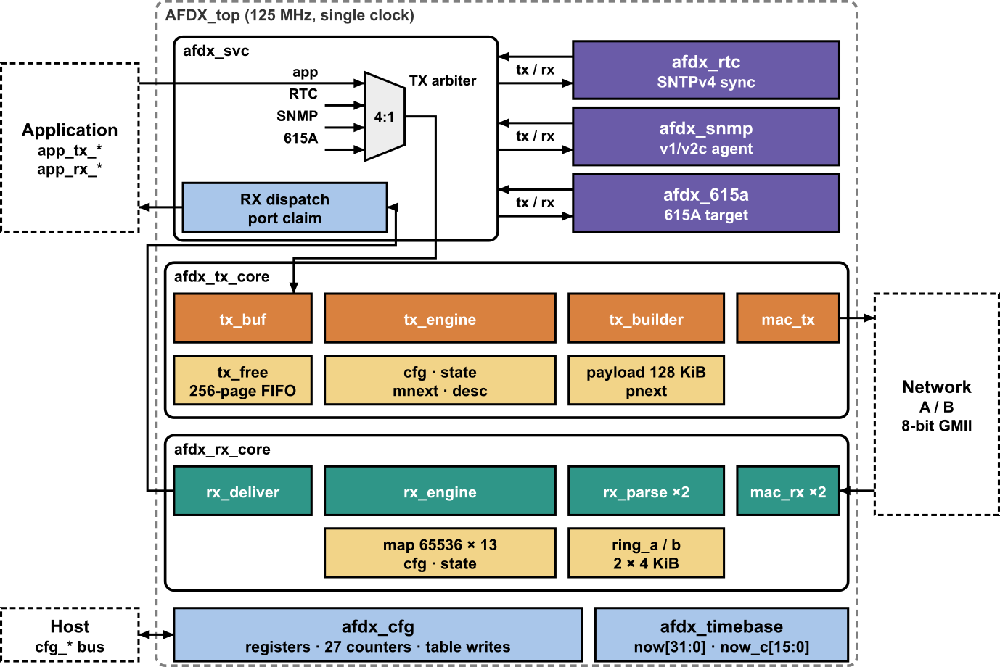
<p><sub>图 1：<code>AFDX_top</code> 端系统微架构——发送侧共享页池与调度（a）及接收侧双环预写与单一交付（b）；各子系统细节见第 4 节。</sub></p>

[技术文档报告（PDF）](docs/report/AFDX端系统FPGA技术文档报告.pdf) · [详细设计报告（PDF）](docs/design/AFDX端系统FPGA设计文档.pdf) · [验证与测试报告（PDF）](docs/test/AFDX端系统FPGA测试报告.pdf) · [顶层接口](#2-顶层接口与集成契约) · [快速复现](#3-快速上手与验证复现) · [架构规划](docs/ARCH.md) · [数据事实清单](docs/FACTS.md)

---

## 1. 核心特性与适用边界

- **全自研流式双网千兆 MAC 与长消息分片重组**：`afdx_mac_tx` / `afdx_mac_rx` 支持 A/B 双网同拍发送前导码、独立 CRC-32 校验与 4 字节移位尾部剥离；应用消息（1～8192 B）按 VL 的 `Lmax` 自动 IPv4 分片（首片携 UDP 首部，逐片按 BAG 发送并递增 AFDX 序号），接收端通过 16 个并发重组上下文（128 KiB RAM）完成整包 UDP 校验并顺序交付。
- **共享页池调度与坏帧无损回退**：发送侧采用 256 页 × 512 B（128 KiB）链式共享页池与 512 拍前瞻窗口（Lookahead）轮询 128 条 TX VL；接收侧支持 4096 条 RX VL（32 Bank 同步映射），双网各自拥有 4 KiB 试写环，坏帧或错包立即回退写指针，在缓存中零脏字节残留。
- **单时钟域 + `CE_DIV=2` 多周期控制面**：全系统共用单一 125 MHz 时钟，无跨时钟域（CDC）路径；数据面每拍 1 字节全速运行，SNMP / 615A 复杂状态机运行在经形式化网表逻辑锥审计的 `CE_DIV=2`（16 ns）多周期使能域（253 组约束覆盖 2,755 个寄存器与 51,992 条路径，0 未覆盖 / 0 非法逻辑锥）。
- **三项片上机载网络服务**：`afdx_svc` 按整包粒度仲裁并路由 SNTPv4（RTC 硬件四时间戳对时，0 ns 稳态误差）、SNMP v1/v2c 代理（ASN.1 BER 编解码，`Get`/`GetNext`/`Set`/`Trap`）以及 ARINC 615A（TFTP A3/A4 协议，8 KiB 镜像上传与 `MEMORY.BIN` 卸载）。

**满载约束与边界**：
- **流量前提**：每条 VL 每个 BAG 最多注入 1 条消息，长消息按分片数占用发送机会；63 VL 满载规格（每 VL `BAG = 1 ms`、`Lmax = 1471 B`，由 70 VL 通过 / 71 VL 溢出二分搜索按 10% 余量确定）下，同时发送长消息的 VL 不超过 3 条，其中并发 8192 B 消息不超过 1 条，A/B 网发送同一业务冗余副本。完整条款见 [网络规划要求](docs/ARCH.md#网络规划要求)。
- **暂不支持的子集**：ARINC 615A 的信息操作、操作员定义卸载后续传输、FIND/WAIT/ABORT、整文件重试与 TFTP 可选项协商；SNMP 的 `GetBulk`、多变量绑定与 v1 `Trap`。
- **测量口径**：吞吐与时延均为 125 MHz RTL 仿真统计（有效载荷去重口径，A/B 副本不叠加）；门级网表仿真使用 eLinx 导出的 VQM（零延迟功能比对）；RTC 同步误差在共理想时钟、对称链路下经配置口读回测得；静态时序覆盖全部内部路径，外部 I/O 时序随板级约束指定。

---

## 2. 顶层接口与集成契约

综合顶层 [`AFDX_top`](rtl/AFDX_top.v#L6-L30) 共引出 172 个用户引脚，采用 125 MHz 单一上升沿同步逻辑（高有效同步复位 `reset`）。

- **应用流握手协议**：`tx_data` 与 `rx_data` 均以 `[2 字节大端 VLID] + [1～8192 字节原始载荷]` 的连续字节流交互。**发送方在启动一条新消息前需确认 `tx_ready == 1`，消息内部保持 `tx_valid` 连续有效（无内部暂停，无 `last` 引脚），两条消息之间至少间隔 1 个 `tx_valid == 0` 的空闲拍。** 接收口按系统约束不使用 `rx_ready` 反压，下游须在 `rx_valid == 1` 期间连续接收整条消息。

| 接口分组 | 信号名称 | 方向 | 协议说明 |
| :--- | :--- | :---: | :--- |
| 时钟与复位 | `clk`、`reset` | 入 | 唯一 125 MHz 主时钟（8.000 ns）；高有效同步复位 |
| 应用发送流 | `tx_data[7:0]`、`tx_valid` | 入 | 首 2 字节为大端 VLID，紧接 1～8192 B 载荷；帧内连续，帧间至少空 1 拍 |
| 应用发送反压 | `tx_ready` | 出 | 核心初始化完成且发送缓冲可容纳下一条消息及描述符时为高 |
| 应用接收流 | `rx_data[7:0]`、`rx_valid`、`rx_ready` | 出 / 入 | 首 2 字节大端 VLID + 重组去重后的完整载荷；忽略 `rx_ready` |
| A/B 双网 GMII | `gmii_txd_{a,b}[7:0]`、`gmii_tx_en_{a,b}`<br>`gmii_rxd_{a,b}[7:0]`、`gmii_rx_dv_{a,b}` | 出<br>入 | 千兆 8 位接口（每拍 1 字节，含前导码、SFD 与 FCS），双网独立并行收发 |
| 主机配置总线 | `cfg_wr`、`cfg_rd`、`cfg_addr[17:0]`、`cfg_wdata[31:0]`<br>`cfg_rdata[31:0]`、`cfg_rvalid`、`cfg_ready` | 入<br>出 | 字寻址配置口，用于加载 128 TX / 4096 RX VL 配置表及读写 MIB/统计计数器 |
| 事件监视脉冲 | `ev_tx[6:0]`、`ev_a[7:0]`、`ev_b[7:0]`、`ev_rm_drop`、`ev_deliver`<br>`ev_app[2:0]` | 出 | 核心状态与异常单拍脉冲；`ev_app` 位[2]/[1]/[0] 依次指示接收溢出 / 发送缓冲不足 / 无效 VLID 丢弃 |

<details>
<summary>AFDX_top 顶层可配置参数（7 项默认值，与官方综合一致）</summary>

| 参数 | 默认值 | 含义 |
| :--- | :---: | :--- |
| `CE_DIV` | `2` | 控制面管理引擎（SNMP / 615A）时钟分频系数（`1` 为全速，`2` 为 16 ns 多周期） |
| `TX_PAGE_AW` | `8` | 发送共享页池页数位宽（`2^8 = 256` 页） |
| `TX_OFF_AW` | `9` | 单页字节偏移位宽（`2^9 = 512 B`，总计 128 KiB） |
| `LOOKAHEAD` | `512` | 发送调度前瞻窗口拍数（512 拍 = 4.096 µs） |
| `RX_RING_AW` | `12` | 单网接收环形缓存地址位宽（`2^12 = 4096 B`） |
| `RX_DQ_AW` | `5` | 接收裁决交付描述符队列深度位宽（32 项） |
| `RX_CONFIG_BANKS` | `16` | 接收 VL 查找表 Bank 布局参数（总容量 4096 条 RX VL） |

</details>

---

## 3. 快速上手与验证复现

**运行环境**：Windows 10/11、eLinx 3.0.7、ModelSim SE-64 2020.4、Windows PowerShell 5.1（工程路径须**不含中文与空格**）。

### 路径一：eLinx GUI 一键行为仿真（最快 · 约 2 分钟 · 无需 Python）

1. 用 eLinx 3.0.7 打开 [`elinx/AFDX_EndSystem.epr`](elinx/AFDX_EndSystem.epr)，在 *Settings → Tool Settings → 3rd Party Simulators* 指定本机 ModelSim 的 `win64` 目录。
2. 在 *Sources → Simulation Sources (`sim_1`)* 确认仿真顶层为 `tb_elinx`（综合顶层为 `AFDX_top`），点击 **Run Behavioral Simulation**。
3. ModelSim 自动编译并执行双端系统经 A/B 双网互发 1、64、1471 B 消息自检，Transcript 窗口打印 `both_directions=PASS` 及 `[RESULT] tb_elinx PASS checks=9238 errors=0`。

*(命令行等价入口：`python -B -X utf8 tools/eda.py sim --test tb_elinx`)*

### 路径二：ModelSim 验收用例与自定义激励（纯 Tcl · 无需 Python）

在 ModelSim Transcript 窗口进入工程根目录 `cd {工程路径}` 后运行：

```tcl
# 1) 一键运行全部 8 个系统级验收用例（约 1,949,513,089 次检查）
do sim/run_judge.do

# 2) 按环境变量单独筛选某一项用例（例如变长多 VL 性能测试）
set ::env(AFDX_JUDGE_CASE) perf_var
do sim/run_judge.do
unset ::env(AFDX_JUDGE_CASE)

# 3) 应用层纯载荷（VLID + 字节流）自定义激励自检，支持替换文本向量
do sim/run_app.do
do sim/run_app.do sim/vectors/app/small_stimulus.txt

# 4) 交互式复现协议波形（切换场景前执行 quit -sim）
do sim/wave/frag.do
```

- 批处理无界面执行：`vsim -batch -do "do sim/run_judge.do; quit -f"`，日志输出至 `out/modelsim/`。
- 自定义向量格式：[`sim/vectors/app/vl_config.txt`](sim/vectors/app/vl_config.txt)（`<VLID_HEX> <BAG_us> <Lmax_B> <Sport> <Dport>`）与 [`sim/vectors/app/stimulus.txt`](sim/vectors/app/stimulus.txt)（`<发送时刻_us> <VLID_HEX> <载荷HEX>`），统计写入 `out/app/`。

### 路径三：命令行综合布线、门级网表比对与全量回归

需 Python 3.10+（实测 3.12.7）及依赖 `python -m pip install psutil pyasn1==0.4.8`。在 PowerShell 中先设置工具路径后按需执行：

```powershell
$env:AFDX_PYTHON='C:\Path\To\python.exe'
$env:MODELSIM_HOME='C:\modeltech64_2020.4\win64'
$env:ELINX_HOME='C:\eLinx3.0.7'
$env:AFDX_CE_DIV='2'
$env:AFDX_MEM_FLOOR_GB='3'
$env:AFDX_MODELSIM_DECL_ORDER='0'

# 1) 一键官方综合与固定簇布局布线（约 27 分钟）+ 全端点时序独立核对
& $env:AFDX_PYTHON -B -X utf8 tools/build_1030.py --route --pres 1.30
& $env:AFDX_PYTHON tools/report_routed_timing.py

# 2) 一键 63 项并行回归（6 路并行，约 30～50 分钟）与双配置隔离入口
$env:AFDX_SIM_TIMEOUT_SECONDS='3600'
& $env:AFDX_PYTHON -B -X utf8 tools/par_regress.py --output out/reproduce_t78 --list sim/t78_quick_tests.txt --branch-tests --raw-sources --max-sims 6 --max-owned-sims 6 --rtl-hours 1
& $env:AFDX_PYTHON -B -X utf8 tools/t76_app.py
& $env:AFDX_PYTHON -B -X utf8 tools/t76_app.py --small

# 3) 综合后 .vqm 门级网表与同激励 RTL 逐字节比对
$net = (Get-Content out/latest_AFDX_top_1030.json -Raw | ConvertFrom-Json).netlist
powershell -NoProfile -ExecutionPolicy Bypass -File sim/run_gui_netlist.ps1 -Test tb_net_services -Netlist $net
```

<details>
<summary>环境变量清单、双配置切换与常见排障说明（6 项）</summary>

| 环境变量 | 作用与默认值说明 |
| :--- | :--- |
| `AFDX_PYTHON` / `MODELSIM_HOME` / `ELINX_HOME` | 分别指定 `python.exe`、ModelSim `win64` 及 eLinx 根目录；缺省按 `PATH` 查找 |
| `AFDX_MEM_FLOOR_GB` / `AFDX_MEM_LIMIT_GB` | 系统可用内存下限（默认 `5 GiB`）与子进程树内存上限（默认 `10 GiB`），`0` 关闭保护；8 GB 电脑建议设为 `1` 和 `4` |
| `AFDX_CE_DIV` | 切换仿真时的 `CE_DIV=1` 或 `2`（官方综合固定默认 `2`）；可配合 `sim/regress.ps1` 与 `run_judge.do` 做隔离双测 |

1. **ModelSim `vsim -c` 偶发 `RPC_Init WinError 10013` 或 GUI 卡在 `Loading...`**：系 `vish/vsim` 间本机 IPv6 回环 `::1` 被代理/VPN 或防火墙拦截；关闭代理或改用 `-batch`（如 `vsim -batch -do "do sim/run_judge.do; quit -f"`）即可绕过 RPC 通道。
2. **日志出现 `vsim-PLI-3003: '$finish_and_return' is not defined` 等 84/90 条 Warning**：属良性诊断（保留了系统任务名与默认不接线的调试口），评测脚本仍对任意 `Error`/`Fatal`/`FAIL`/`RAMCOLL` 执行零容忍判定。
3. **eLinx GUI 读取 `physical_only.edc` 打印 `invalid command`**：GUI 会对登记的约束先做一次 `read_sdc` 再执行 Tcl `source`；SDC 解析器忽略 `.edc` 物理命令，随后已由 `source` 完整生效。
4. **RTL 中 `MODEL_TECH` 条件宏的作用**：7 份文件用它兼容 ModelSim 前置声明检查；eLinx 综合不定义该宏，保持原网表拓扑不变（严禁手动在综合脚本中定义 `MODEL_TECH`）。
5. **为何 VQM 网表仿真前调用 `tools/adapt_gui_vqm.py`**：eLinx 导出的 `.vqm` 省略了取默认值的端口与参数，仅在仿真副本上补齐默认上下拉输入及进位链 `cin_used="true"`，绝不触碰任何逻辑连接与真值表。
6. **修改 RTL 后如何刷新约束**：请先带 `--no-tiles` 自由布线，再执行 `python tools/check_multicycle.py <新VQM路径> --constraints elinx/constraints.edc --output out/multicycle_audit --refresh` 自动重审多周期锥；增删 RTL 模块时同步更新唯一清单 [`elinx/afdx_all.v`](elinx/afdx_all.v) 并跑 `python tools/check_wrapper.py`。

</details>

---

## 4. 微架构与核心数据通路

工程采用 [`elinx/afdx_all.v`](elinx/afdx_all.v) 作为唯一源文件聚集入口，按固定顺序包含全部 34 个可综合模块，确保 GUI 与命令行读取完全一致的 RTL 集合。

### 4.1 端到端数据通路与分片帧映射

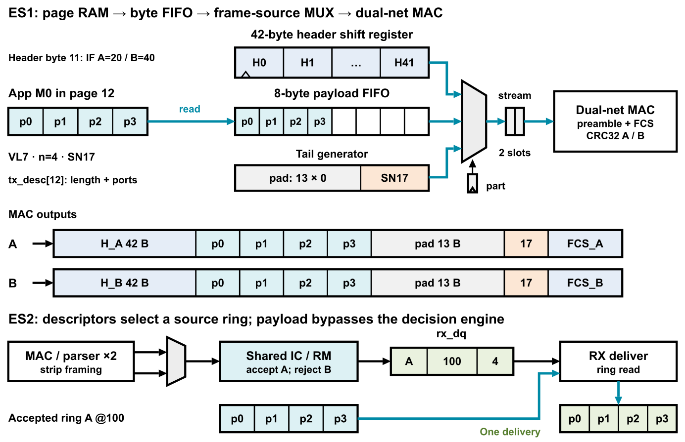
<p><sub>图 2：收发两端字节流贯穿路径与双网冗余帧结构（A/B 网仅源 MAC 接口标识不同）。</sub></p>

<details>
<summary>展开查看：AFDX 单帧与 IPv4 分片帧字节布局（f06_frame）</summary>

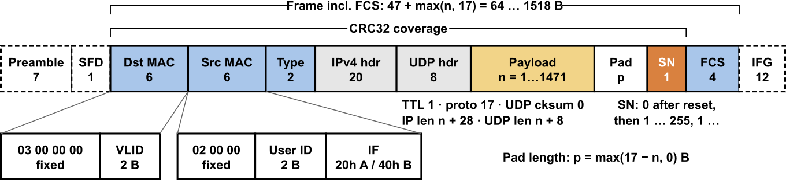
<p><sub>图 3：Ethernet / IPv4 / UDP 首部、片偏移、短帧补零、AFDX 序号（SN）与 FCS 字节布局。</sub></p>

</details>

### 4.2 发送核心：链式页池、Lookahead 调度与分片 (`afdx_tx_core`)

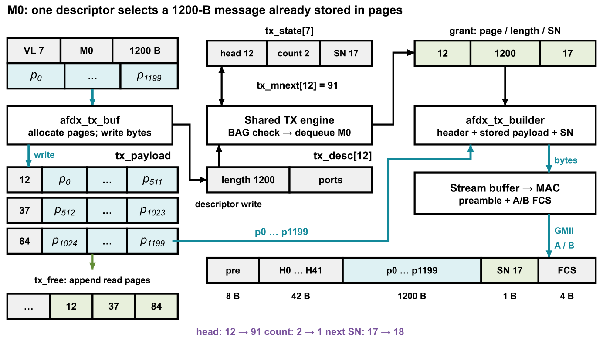
<p><sub>图 4：发送核心跨页链式存储（<code>tx_pnext</code> / <code>tx_mnext</code>）与页面即时回收闭环。</sub></p>

- **应用预缓存与跨页池化**：`afdx_app_tx` 配有 32 KiB 弹性切片缓存（8 Bank × 4×1 KiB）吸收高达 8192 B 的连续突发写入；核心缓冲通过 256×512 B 页链表动态串联长消息，组帧器每读完一页立即由 4 项回收 FIFO 归还空闲页池，消除定长分区碎片。
- **Lookahead BAG 整形与分片控制**：调度器围绕单一状态表写口执行 `START > ENQ > GRANT > SCAN` 仲裁，提前 512 拍预取下一页载荷并在 GMII 帧起始时刻按 `t_start + BAG` 刷新期限；128 条 TX VL 的分片元信息与偏移拆分为三张同步 SDP 表，每片独立遵守 BAG 并递增 SN。

<details>
<summary>展开查看：发送调度四级优先仲裁状态机（f08_txfsm）</summary>

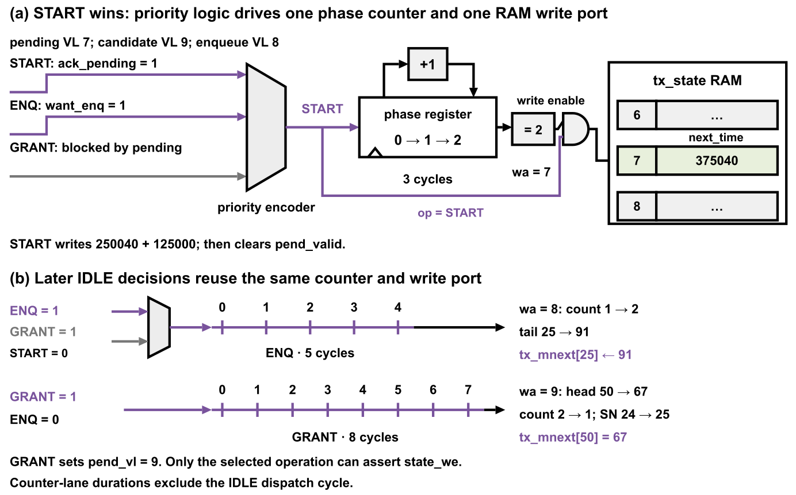
<p><sub>图 5：<code>START > ENQ > GRANT > SCAN</code> 四级优先仲裁与单写口冲突消除。</sub></p>

</details>

### 4.3 接收核心：试写回退环、IC/RM 裁决与 16 上下文重组 (`afdx_rx_core`)

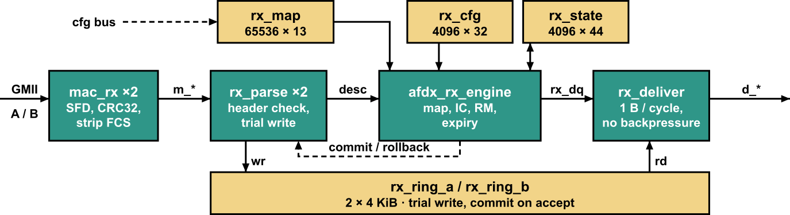
<p><sub>图 6：4096 项 RX VL 分组映射（32 Bank 同步 RAM）与接收描述符结构。</sub></p>

- **边收边写与坏帧零残留回退**：A/B 两网独立配备 `afdx_mac_rx`、`afdx_rx_parse` 与 4 KiB 接收环；帧字节按试写指针 `trial_ptr` 实时写入，一旦检出 FCS 错误、长度或首部异常则将指针无损回退至 `commit_ptr`，确保环内不留脏数据。
- **共享 IC/RM 与 16 槽位并发重组**：`afdx_rx_engine` 对双网描述符执行序号完整性检查（IC，支持复位同步、连续号及丢 1 帧容忍）与冗余管理（RM，按 Skew 时间窗去重）；分片帧接纳后立刻搬入双 8 行（共 16 上下文、128 KiB）重组槽位，防止慢速长包阻塞短帧接收环，集齐并通过整包非零 UDP 校验和核验后经 `afdx_rx_deliver` 连续交付。

<details>
<summary>展开查看：双网并发预写、IC/RM 裁决与试写指针回退机制（f13_decide）</summary>

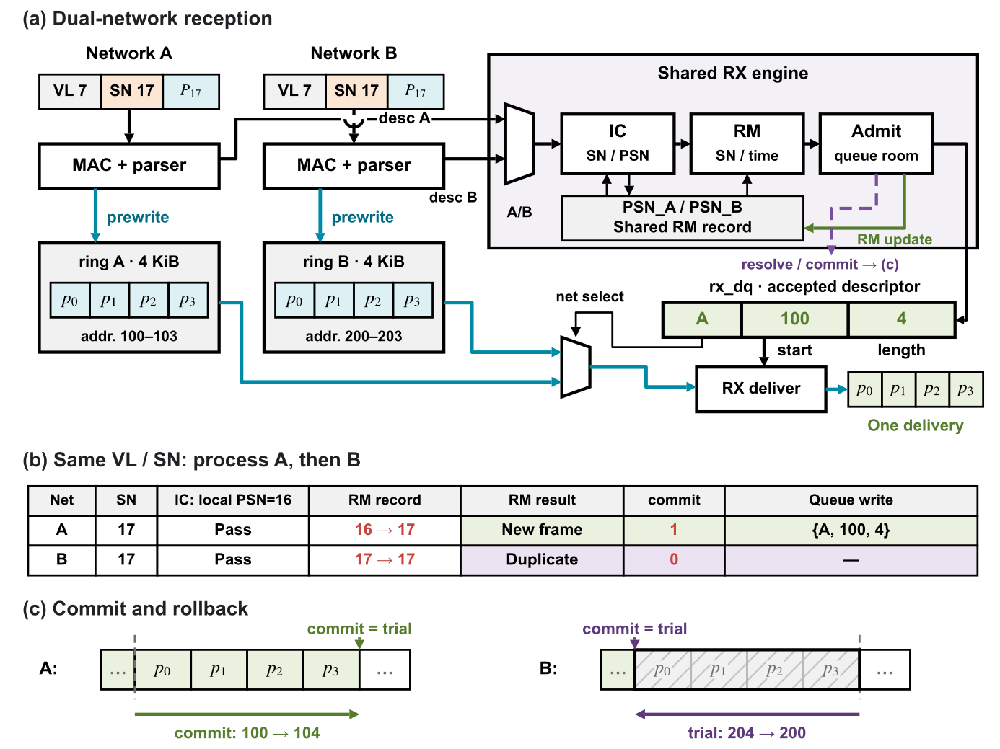
<p><sub>图 7：双路 4 KiB 试写环并行预写、共享 IC/RM 裁决与坏帧回退。</sub></p>

</details>

### 4.4 片上机载网络服务 (`afdx_svc` / `CE_DIV=2`)

- **SNTPv4 (RTC)**：硬件维护 32 位秒 + 32 位纳秒时钟，在收发首字节拍直接锁存 `t1..t4` 四个时间戳；通过无 DSP 移位加减单元互转纳秒与 NTP 二进制小数并补偿 5 拍流水延迟，稳态同步误差 `0 ns`。
- **SNMP v1/v2c 与 ARINC 615A**：全速接口壳完成报文捕获与发送响应，低速 `CE_DIV=2` 引擎分别执行 ASN.1 BER 编解码（支持系统 MIB 与私有统计读写及主动 `Trap`，主机写优先）与 TFTP A3/A4 状态机（自动完成 `LUI→LUS→LUR→LUH→DATA` 8 KiB 加载与 `MEMORY.BIN` 卸载 CRC-16 校验）。

<details>
<summary>展开查看：RTC 对时、SNMP 代理与 ARINC 615A 协议交互图（f14 ~ f16）</summary>

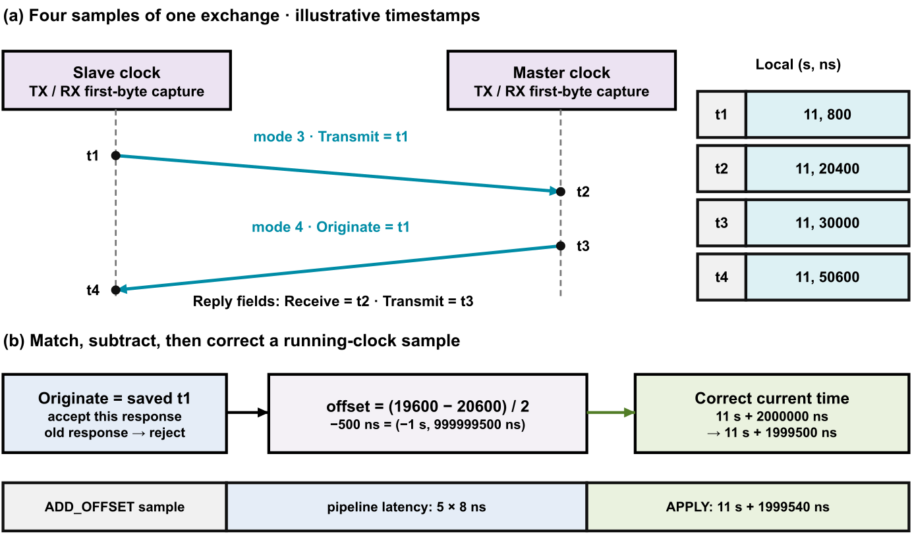
<p><sub>图 8：RTC 四时间戳双向对时与流水线补偿。</sub></p>

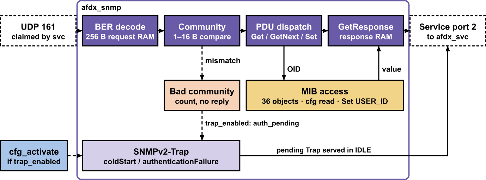
<p><sub>图 9：SNMP v1/v2c BER 解析与 MIB 读写回显。</sub></p>

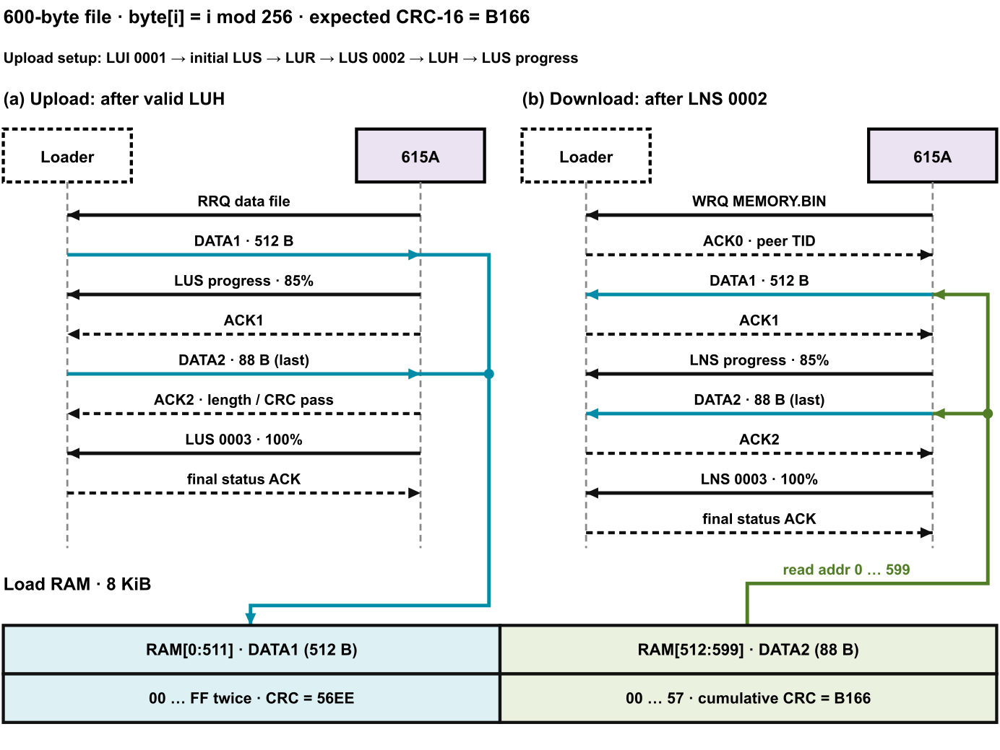
<p><sub>图 10：ARINC 615A（TFTP）镜像加载与卸载流程。</sub></p>

</details>

<details>
<summary>展开查看：全部 34 个可综合 Verilog 模块清单（按子系统分组）</summary>

#### 顶层与公共基础设施（7 个）
| RTL 文件 | 职责 |
| :--- | :--- |
| `rtl/AFDX_top.v` | 可综合顶层：2 B 大端 VLID 应用字节流接口、A/B 双网 GMII、配置与事件口（172 引脚） |
| `rtl/afdx_es.v` | 端系统核心集成：互联收发核心、GMII、配置总线、时基与三项网络服务（单 125 MHz） |
| `rtl/afdx_cfg.v` | 配置总线解码与寄存器管理：主机/SNMP 仲裁、VL 配置表写入及事件计数器 |
| `rtl/afdx_timebase.v` | 全局时基：生成 8 ns 细粒度计数 `now` 与 32.768 µs 粗粒度冗余判定时标 `now_c` |
| `rtl/afdx_ram_sdp.v` | 参数化同步简单双端口 RAM（1 写 + 1 同步读），精准映射器件 M4K 原语 |
| `rtl/afdx_crc32_d8.v` | 单字节 8 位并行 Ethernet CRC-32 组合更新单元 |
| `rtl/afdx_svc.v` | 消息级仲裁与分发器：整包粒度仲裁发送并按 UDP 端口路由 SNTP/SNMP/615A 报文 |

#### 应用流封装层（5 个）
| RTL 文件 | 职责 |
| :--- | :--- |
| `rtl/afdx_app_tx.v` | 解析首 2 B VLID 并反查发送配置，将最多 8192 B 消息写入应用缓存并提交 |
| `rtl/afdx_app_payload.v` | 应用层 32 KiB 弹性切片存储（8 Bank × 4×1 KiB 切片流水） |
| `rtl/afdx_app_read.v` | 从 `afdx_app_payload` 连续预取字节流送入核心发送缓冲 |
| `rtl/afdx_app_rx.v` | 接收核心交付载荷，反查 16 位 VLID 拼接于首部后连续输出至 `rx_data` |
| `rtl/afdx_app_map.v` | 同步保存接收 VL 索引与 16 位 VLID 的反向映射 RAM |

#### 发送核心与双网 MAC（7 个）
| RTL 文件 | 职责 |
| :--- | :--- |
| `rtl/afdx_tx_core.v` | 发送子系统顶层：整合缓冲、空闲页池、调度、组帧与双路发送 MAC |
| `rtl/afdx_tx_buf.v` | 动态申请 512 B 页写入 128 KiB 共享页池，维护页链 `tx_pnext` 与消息链 `tx_mnext` |
| `rtl/afdx_tx_free.v` | 管理 256 个 512 B 物理页的空闲链表与实时回收 |
| `rtl/afdx_tx_engine.v` | 轮询 128 条 TX VL，按 BAG 与 Lookahead 窗口授权，维护分片进度与 AFDX SN |
| `rtl/afdx_tx_builder.v` | 按授权组装 Ethernet/IPv4/UDP 首片与分片首部、短帧补零及帧尾 SN |
| `rtl/afdx_mac_tx.v` | 自研千兆发送 MAC：同拍驱动 A/B 网前导码/SFD、独立 FCS 计算及强制 12 拍 IFG |
| `rtl/afdx_mac_rx.v` | 自研千兆接收 MAC：校验前导码、帧长与 FCS，4 B 滑动窗口剥离 FCS |

#### 接收核心与分片重组（8 个）
| RTL 文件 | 职责 |
| :--- | :--- |
| `rtl/afdx_rx_core.v` | 接收子系统顶层：整合双网 MAC、并发解析、共享裁决、16 上下文重组与交付 |
| `rtl/afdx_rx_parse.v` | 校验 MAC/IPv4/UDP 首部并预写 4 KiB 接收环；坏帧回退写指针 |
| `rtl/afdx_rx_engine.v` | 查询 4096 项 VL 映射，执行 IC 检查与 RM 双网去重，协调分片准入与交付 |
| `rtl/afdx_rx_reassembly.v` | 16 上下文 IPv4 分片重组顶层：槽位预留、复制、超时老化与整包 UDP 校验 |
| `rtl/afdx_rx_reassembly_bank.v` | 8 行重组上下文状态机：维护匹配键、期待偏移、总长与 UDP 校验和累加 |
| `rtl/afdx_rx_reassembly_payload.v` | 管理 8 个 8192 B 重组槽位（双 Bank 共 128 KiB），四路双位切片优化扇出 |
| `rtl/afdx_rx_reassembly_ram.v` | 重组专用同步 SDP M4K 存储器封装（写地址提前一拍本地寄存优化时序） |
| `rtl/afdx_rx_deliver.v` | 从 A/B 接收环或重组槽位预取有效载荷，向应用或服务层连续无反压交付 |

#### 片上机载网络服务（7 个）
| RTL 文件 | 职责 |
| :--- | :--- |
| `rtl/afdx_rtc.v` | RTC 硬件时钟与 SNTPv4 引擎：首字节拍打时间戳、双向对时与超时重传 |
| `rtl/afdx_ntp_fraction.v` | 纳秒与 NTP 32 位二进制小数双向迭代换算器（移位加减，零 DSP） |
| `rtl/afdx_snmp.v` | SNMP 全速接口壳：捕获请求报文、桥接 MIB 配置总线并驱动响应发送 |
| `rtl/afdx_snmp_engine.v` | SNMP 协议引擎（`CE_DIV=2`）：ASN.1 BER 编解码与 `Get/GetNext/Set/Trap` |
| `rtl/afdx_615a.v` | ARINC 615A 全速壳：捕获 TFTP/615A 报文，例化 8 KiB 加载 RAM |
| `rtl/afdx_615a_engine.v` | ARINC 615A 协议引擎（`CE_DIV=2`）：驱动上传/卸载状态机及 CRC-16 校验 |
| `rtl/afdx_mgmt_tx.v` | 管理服务全速发送器：125 MHz 全速读取响应 RAM 并连续送入 `afdx_svc` |

</details>

---

## 5. 实现结果与验证证据

### 5.1 EDA 资源与静态时序收敛（eLinx 3.0.7 · `EQ6HL130-CSG484_H`）

通过 `tools/build_1030.py --route --pres 1.30` 加载 `elinx/tiles_1030.edc`（11,044 个固定簇位置与 172 个 P0 管脚）完成实现；完整报告与按网表 SHA256 绑定的摘要见 [`1030_IMPLEMENTATION.md`](docs/1030_IMPLEMENTATION.md) 与 [`timing.json`](docs/evidence/frag1030_delivery/timing.json)。

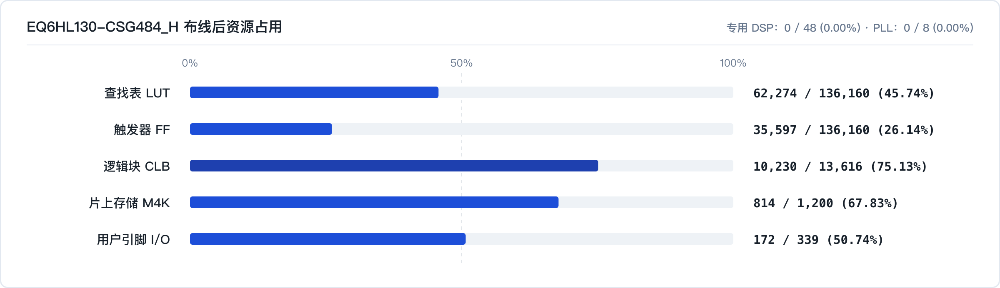
<p><sub>图 11：布线后资源实测占用（按标准器件容量 136,160 LUT/FF、13,616 CLB 统计）。</sub></p>

| 时序阶段与路径类型 | 最差裕量 (Setup / Hold) | 约束与覆盖路径 | 失败端点 |
| :--- | :---: | :--- | :---: |
| 综合后静态时序 | `+4.148 ns` / `+0.192 ns` | 8.000 ns 主时钟（含 0.30 ns 不确定度） | `0 / 164,745` |
| 布线后静态时序 | **`+0.029 ns`** / **`+0.604 ns`** | 8.000 ns 主时钟（含 0.30 ns 不确定度） | **`0 / 96,142`** |
| 8 ns 单周期路径 | `+0.029 ns` | 269,131 条（全速数据面、捕获、RAM、GMII） | `0` |
| 16 ns 多周期路径 | `+0.720 ns` | 50,050 条（253 组 `CE_DIV=2` 控制面引擎） | `0` |
| 同沿 Hold 路径 | `+0.604 ns` | 319,181 条（全内部路径） | `0` |

<details>
<summary>展开查看：eLinx 3.0.7 实现面板摘要与 GUI 行为仿真通过截图</summary>

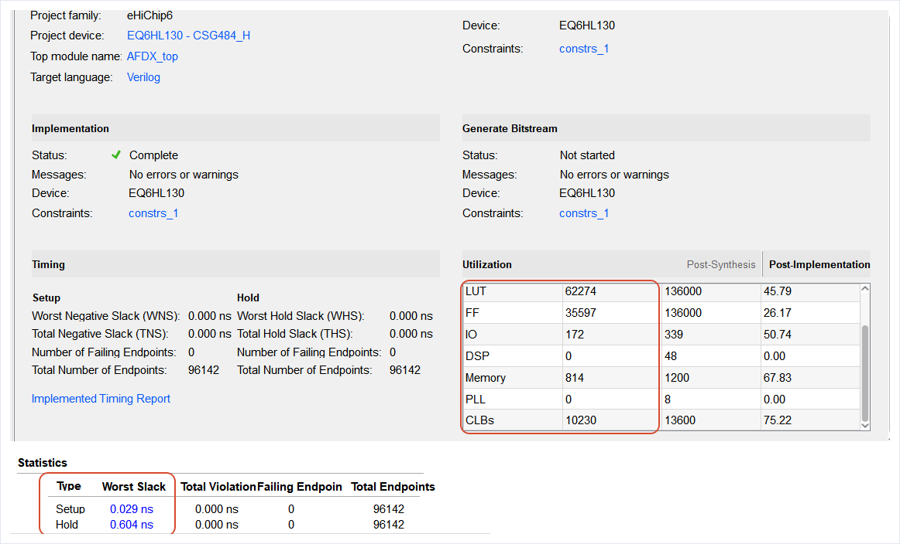
<p><sub>图 12：eLinx 3.0.7 实现总览与 Timing Statistics（注：GUI 摘要表内按 136,000 LUT/FF 与 13,600 CLB 整数分母显示，与命令行报告按真实容量计算的百分比差约 0.05%）。</sub></p>

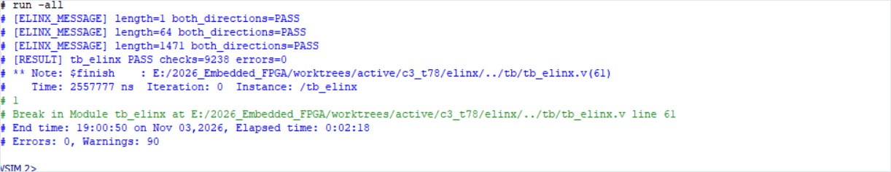
<p><sub>图 13：从 eLinx 一键启动行为仿真 <code>tb_elinx</code>，双端互发 1/64/1471 B 全部通过（<code>checks=9238 errors=0</code>）。</sub></p>

</details>

### 5.2 吞吐、时延与 63 VL 满载实测边界

| 负载场景 | 活跃 VL / 端 | 单向有效载荷吞吐 | 说明 |
| :--- | :---: | ---: | :--- |
| 满载交付规格 | 63 TX / 63 RX | **`741.384 Mbps`** | 双向合计 1482.768 Mbps（线速占用 77.5%），7 大场景各连续 100 ms 零丢包 |
| 定长满载压测 | 77 TX / 77 RX | `906.136 Mbps` | 全固定 1471 B 帧连续注入千兆压测 |
| 超规格补充口径 | 81 TX / 81 RX | `953.208 Mbps` | 81 VL 定长补充压测，见 [总吞吐表](docs/evidence/t76_frag1030/total_throughput.tsv)（case 0） |

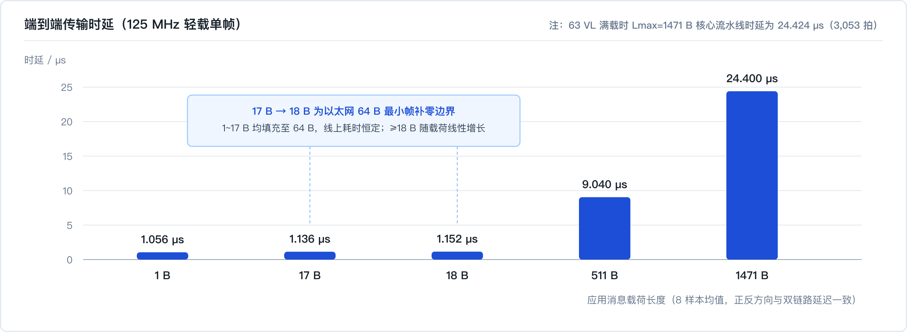
<p><sub>图 14：不同载荷长度的端到端传输时延及 64 B 最小帧填充边界。</sub></p>

- **63 VL 双向 100 ms 七工况全过**（详表见 [`t79_63vl/summary.md`](docs/evidence/t79_63vl/summary.md)）：
  - **5 种典型载荷（1 / 17 / 256 / 1024 / 1471 B）周期注入**：连续 100 ms 零丢失，最大抖动 `3.360 µs`。
  - **BAG 等待场景（`BAG_BURST`）**：轮换输入顺序场景下全部分组抖动 `< 100 µs`（最大 `96.752 µs`）；固定顺序完整性与双统计 100% 通过。
  - **长短消息混合满载（60×1471 B + 3 条分片 1472/3000/8192 B）**：连续 100 ms 交付 12,206 条消息零丢包、逐字节一致，TX 页池峰值严格 ≤ 256 页。
  - **超规格极值探测**：81 VL 周期注入（最大抖动 `3.368 µs`）与 81 VL BAG 撞车均完整交付（最大抖动 `107.7 µs`）；63 VL 下并发 2 条 8192 B 零丢失，3～4 条并发 8192 B 触及接收环容量上限，与按 10% 余量定为 63 VL 规格吻合。

### 5.3 三级签核验收、覆盖率与协议实测波形

构建双端系统（`ES1 ↔ ES2`）+ 四通道损伤网络（延迟、偏斜、FCS 误码、丢包、乱序重放）+ 独立 Python 参考模型（[`afdx_ref.py`](tools/afdx_ref.py) / [`fragment_ref.py`](tools/fragment_ref.py)）与 VQM 门级网表比对闭环，累计完成 **1,949,513,089** 次硬件检查（0 错误、0 RAM 冲突），63 项并行回归 **63/63 PASS**（证据见 [`judge_result_frag1030.txt`](sim/reference/judge_result_frag1030.txt) 与 [`regression.json`](docs/evidence/frag1030_delivery/regression.json)）。

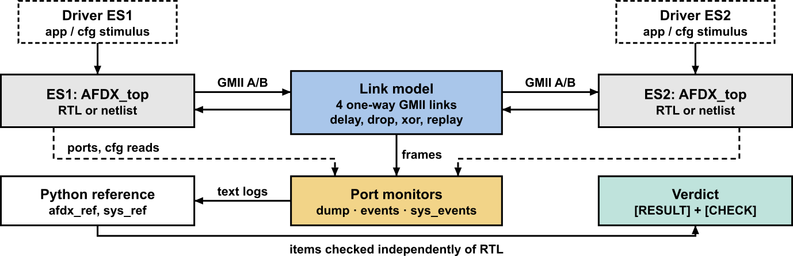
<p><sub>图 15：双端系统、四通道可编程损伤网络与参考模型协同验证平台。</sub></p>

| 验收用例 | 检查点数 (Checks) | 耗时 (s) | 核心验证内容 | 状态 |
| :--- | ---: | ---: | :--- | :---: |
| `services` | `1,123` | `9.472` | 用户收发、IC/RM、SNMP、RTC 对时、615A 上传卸载全闭环 | PASS |
| `capacity` | `49,924` | `13.669` | 每端 4096 条 RX VL（抽检 0/4095 及中间 126 项）与 128 条 TX VL 全量收发 | PASS |
| `snmp` | `699` | `52.593` | `Get`/`GetNext`/`Set` 回显、MIB 寄存器一致性与启动 `Trap` | PASS |
| `burst77` | `530,802` | `16.180` | 77 VL 满长帧同时突发，排空时间 `983.720 µs`（< 1 ms），零丢包 | PASS |
| `burst81` | `554,734` | `17.325` | 81 VL 超规格突发，排空时间 `1032.936 µs`，零丢包 | PASS |
| `rtc` | `10,675,841` | `475.577` | SNTPv4 同步误差：空载、普通流量均为 `0 ns`，77 VL 满载 `8 ns`（一拍） | PASS |
| `performance` | `683,408,635` | `3099.543` | 定长千兆满载（77 VL）：注入 `906.136 Mbps`，最大时延 `48.600 µs` | PASS |
| `perf_var` | `1,254,291,331` | `4638.304` | 变长多 VL 四工况（高载 `904.752 Mbps`，同长最大抖动 `19.544 µs`） | PASS |

| RTL 代码覆盖率维度（58 份 UCDB · 42 设计单元 · 零排除项） | 命中 / 总计 | 实测覆盖率 | 证据文件 |
| :--- | :---: | :---: | :--- |
| 语句覆盖率 (Statement) | `12,416 / 12,824` | **96.8%** | [`coverage_source.md`](docs/evidence/t79_63vl/coverage_source.md) |
| 分支覆盖率 (Branch) | `7,230 / 7,642` | **94.6%** | [`coverage_frag1030.json`](docs/evidence/t79_63vl/coverage_frag1030.json) |
| FSM 状态 / 表达式 / 条件 / 翻转 / 跳转 | `115/137` 等 | `83.9%` / `81.3%` / `74.0%` / `71.9%` / `37.6%` | 同上 |

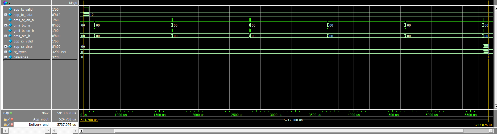
<p><sub>图 16：8192 B 长消息 6 分片发送与重组一次交付实测波形（末片到达后输出 <code>rx_bytes = 8194</code>）。</sub></p>

<details>
<summary>展开查看：三级签核流程图、其余 5 组核心波形与 16 组完整波形窗口索引表</summary>

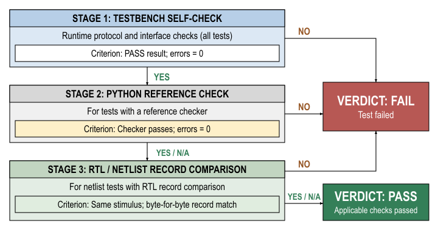
<p><sub>图 17：三级签核流程（硬件在线自检、Python 参考模型核对、VQM 门级网表逐字节比对）。</sub></p>

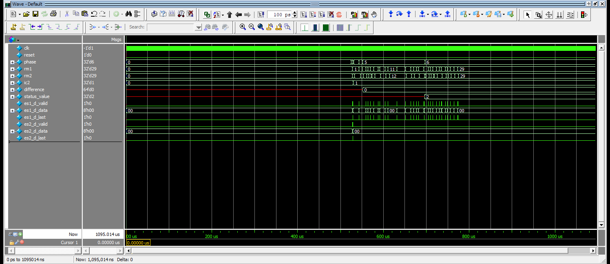
<p><sub>图 18：五功能联测全程波形（用户收发、IC 拒收、SNMP、RTC 对时与 615A）。</sub></p>

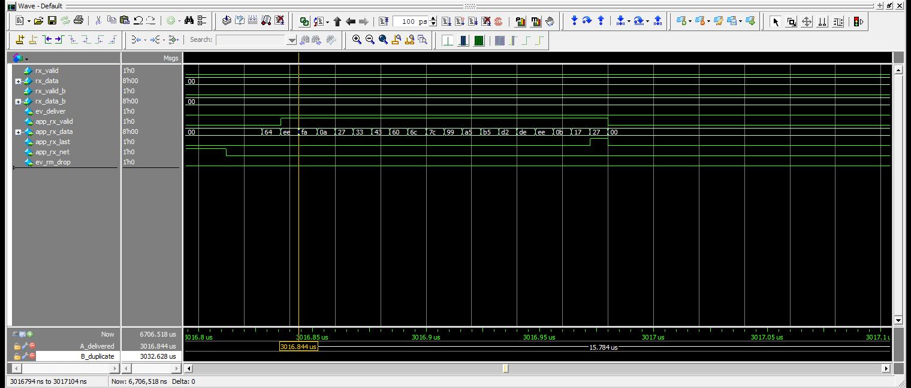
<p><sub>图 19：先到的 A 网副本交付应用（<code>3016.844 µs</code>，<code>app_rx_net = 0</code>）。</sub></p>

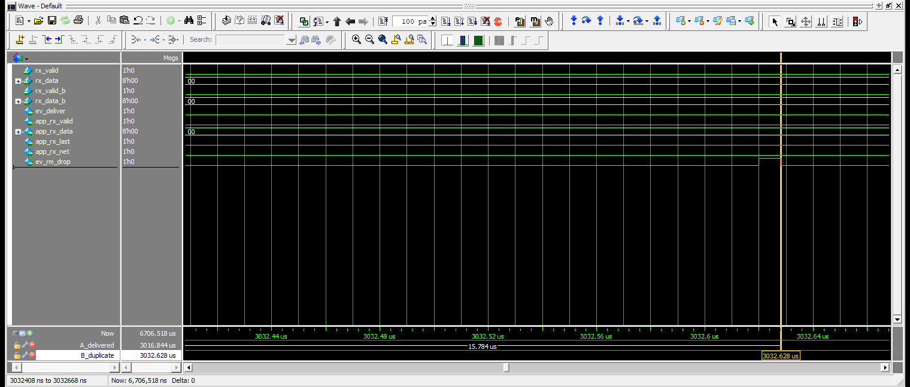
<p><sub>图 20：晚到 `15.784 µs` 的 B 网副本被 RM 滤除（<code>3032.628 µs</code>，触发 <code>ev_rm_drop</code>）。</sub></p>

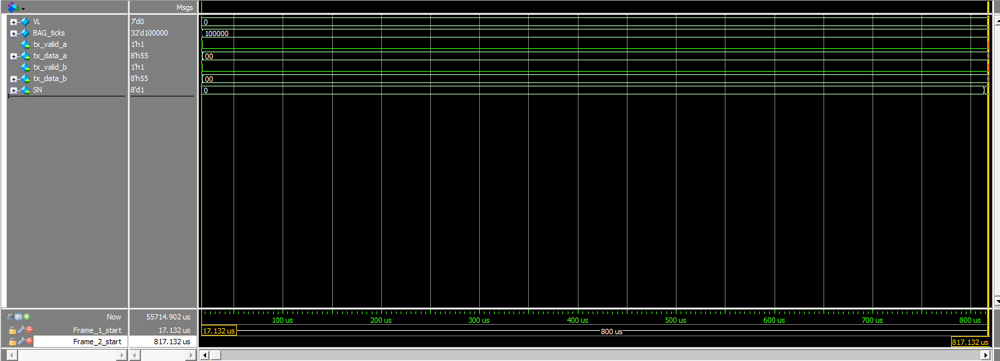
<p><sub>图 21：同一 VL 严格按 `800 µs`（100,000 拍）BAG 间隔发送并递增 SN。</sub></p>

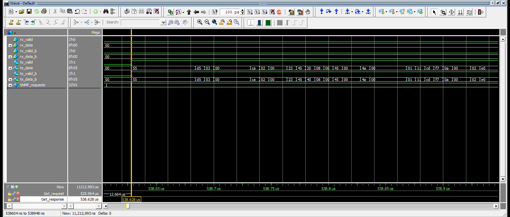
<p><sub>图 22：SNMP `Get` 请求到达后 `12.664 µs` 内双网发出 `GetResponse`。</sub></p>

所有 16 组完整原始截图与 SHA256 校验记录位于 `sim/wave/png/` 与 [`wave_provenance.json`](docs/evidence/t79_63vl/wave_provenance.json)，可通过 `do sim/wave/<场景>.do` 复现：

| 原始波形截图 | 时间窗口 (µs) | 关键事件与观测点 |
| :--- | :---: | :--- |
| [`tx_dual_1.png`](sim/wave/png/tx_dual_1.png) / [`_2`](sim/wave/png/tx_dual_2.png) | `686.272 – 689.372` | 双网同拍发出前导码 `55`；仅源 MAC 接口标识（`20` / `40`）不同 |
| [`rx_redundancy_1.png`](sim/wave/png/rx_redundancy_1.png) / [`_2`](sim/wave/png/rx_redundancy_2.png) | `3016.794 – 3032.668` | 先到 A 网交付（`app_rx_net=0`），晚到 `15.784 µs` 的 B 网副本触发 `ev_rm_drop` |
| [`rx_fcs_error_1.png`](sim/wave/png/rx_fcs_error_1.png) / [`_2`](sim/wave/png/rx_fcs_error_2.png) / [`_3`](sim/wave/png/rx_fcs_error_3.png) | `798.620 – 973.436` | A 网 FCS 错帧回退并触发 `ev_a=02`，两拍后配置口 `0x49` 读回错帧计数 `1` |
| [`tx_bag.png`](sim/wave/png/tx_bag.png) / [`first`](sim/wave/png/tx_bag_first.png) / [`second`](sim/wave/png/tx_bag_second.png) | `16.132 – 819.132` | `17.132 µs` 与 `817.132 µs` 严格相隔 `800 µs`，序号由 `SN=0` 递增至 `1` |
| [`snmp_get_1.png`](sim/wave/png/snmp_get_1.png) / [`_2`](sim/wave/png/snmp_get_2.png) | `525.944 – 538.948` | 请求 `525.964 µs` 到达，代理 `538.628 µs` 发回 `GetResponse`（耗时 `12.664 µs`） |
| [`services.png`](sim/wave/png/services.png) | `0 – 1095.014` | 五功能联测全程闭环，RTC 误差 `0 ns` |
| [`frag_1.png`](sim/wave/png/frag_1.png) / [`_2`](sim/wave/png/frag_2.png) / [`_3`](sim/wave/png/frag_3.png) | `474.768 – 5787.076` | 首片 `Flags/Offset = 20 00`（`MF=1`），6 分片 1 ms BAG 发出后交付 `8194` 字节 |

</details>

---

## 6. 仓库目录、文档索引与项目背景

```text
afdx/
├── rtl/       # 34 个可综合 Verilog-2001 硬件模块（AFDX_top 为工程顶层）
├── tb/        # 58 个自检 Testbench 与四通道可编程损伤链路（tb/lib/）
├── sim/       # ModelSim 验收脚本（run_judge.do / run_app.do）、向量与 18 张原始波形截图
├── tools/     # 综合构建（build_1030.py）、并行回归（par_regress.py）、Python 参考模型与时序/多周期审计
├── elinx/     # eLinx 3.0.7 工程（AFDX_EndSystem.epr）、聚合入口 afdx_all.v 与 .sdc/.edc 约束
└── docs/      # 正式竞赛 PDF 报告、ARCH.md、1030_IMPLEMENTATION.md、FACTS.md 与全部可溯源实验证据
```

- **核心技术文档**：[技术文档总报告（PDF）](docs/report/AFDX端系统FPGA技术文档报告.pdf) · [详细设计文档（PDF）](docs/design/AFDX端系统FPGA设计文档.pdf) · [验证测试报告（PDF）](docs/test/AFDX端系统FPGA测试报告.pdf) · [架构与网络规划（ARCH）](docs/ARCH.md) · [分片与时序收敛记录](docs/1030_IMPLEMENTATION.md) · [数据事实清单（FACTS）](docs/FACTS.md)
- **项目背景**：2026 全国大学生嵌入式芯片与系统设计竞赛（FPGA 创新设计赛道）· 中科亿海微企业命题 · 参赛队 49913
