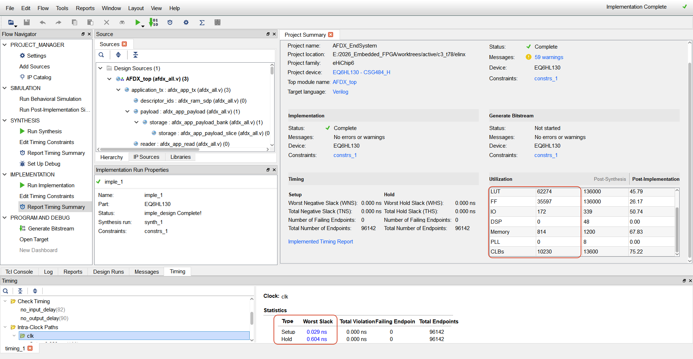
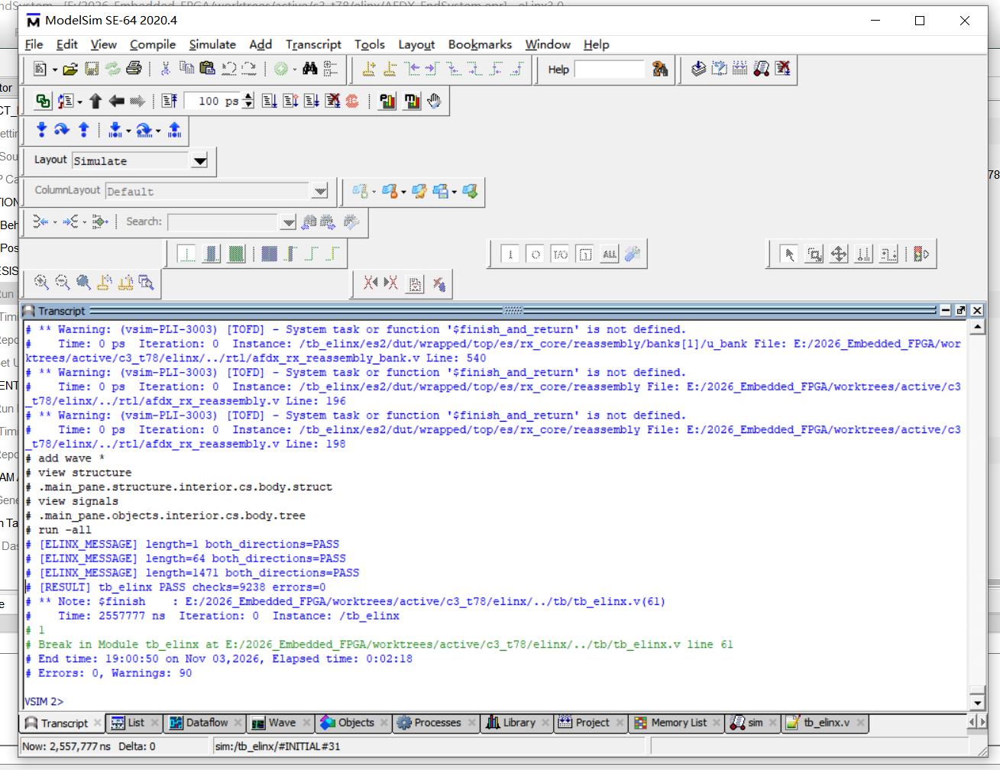

# AFDX 端系统 FPGA 控制器（`AFDX_top`）

ARINC 664 Part 7 机载确定性网络端系统，单器件、单时钟域实现双网千兆收发、8192 B IPv4 分片重组与三项机载网络服务。

2026 全国大学生嵌入式芯片与系统设计竞赛（FPGA 创新设计赛道）· 中科亿海微企业命题 · 参赛队 49913

| 核心指标 | 实测（分片版 `AFDX_top`） |
| :--- | :--- |
| 器件与时钟 | `EQ6HL130-CSG484_H`，单 125 MHz 时钟域（8.000 ns），172 用户引脚 |
| 布线后时序 | setup `+0.029 ns` / hold `+0.604 ns`，**失败端点 0 / 96,142** |
| 单向有效载荷吞吐 | **741.384 Mbps/方向**，63 TX / 63 RX VL 满载，0 丢包 |
| 端到端时延 | **24.424 µs**（`Lmax=1471 B` 帧）；1.056 µs（载荷 1 B 帧） |


<p><sub>图 1：<code>AFDX_top</code> 微架构；各子系统见第 2 节。</sub></p>

[技术文档报告（PDF）](docs/report/AFDX端系统FPGA技术文档报告.pdf) · [详细设计报告（PDF）](docs/design/AFDX端系统FPGA设计文档.pdf) · [验证与测试报告（PDF）](docs/test/AFDX端系统FPGA测试报告.pdf) · [快速复现](#4-三档快速复现指南) · [架构与网络规划](docs/ARCH.md) · [分片实现记录](docs/1030_IMPLEMENTATION.md)

---

## 1. 项目定位与核心架构

顶层模块 `AFDX_top` 面向中科亿海微 eHiChip6 `EQ6HL130-CSG484_H` 器件，在单一 125 MHz（8.000 ns）时钟域下实现 ARINC 664 Part 7 确定性虚拟链路收发与三大机载网络协议栈，不使用外部软核 CPU 或第三方商业以太网 IP 核。交付物为可综合 Verilog-2001 源码、ModelSim 验证平台与 Python 参考模型工具链。

### 核心架构

1. 自研双网千兆 MAC，8192 B 长消息 IPv4 分片与 16 上下文并发重组
   - 自研流式 `afdx_mac_tx` / `afdx_mac_rx` 引擎（双网同拍前导码发送、独立 CRC-32 生成与 4 字节移位尾部剥离），支持用户数据发送、用户数据接收（VL 映射、BAG 整形、IC 序号完整性与 RM 双网冗余去重）、SNTPv4 (RTC) 时钟同步、SNMP v1/v2c 网络管理（Get/GetNext/Set/Trap）及 ARINC 615A（TFTP A3/A4）数据加载与卸载五项赛题功能。
   - 支持单条应用消息 1～8192 字节传输：发送侧按 `Lmax` 自动执行 IPv4 分片（首片携带 UDP 头，每片独立遵守 VL BAG 并递增 AFDX 序号 SN）；接收侧在逐帧 FCS/IP 校验与 IC/RM 裁决后，通过 16 个并发重组上下文（128 KiB 重组载荷 RAM）完成分片重组与整包非零 UDP 校验和验证。

2. 链式共享页池 + Lookahead 预取调度，支撑 63 VL 满载 741.384 Mbps 零丢包
   - 采用全同步单端口写/同步读 M4K 片上 RAM（`afdx_ram_sdp`），支持 128 条发送 VL / 4096 条接收 VL 大容量配置。
   - 发送侧以 256 页 × 512 B（128 KiB）链式共享页池配合 512 拍前瞻窗口（Lookahead）轮询调度；接收侧以每网独立 4 KiB 字节环（边解析边预写、坏帧指针无损回退）配合共享单写口裁决引擎。在每端 63 TX / 63 RX VL 双向满载（每 VL `BAG = 1 ms`、`Lmax = 1471 B`，单向有效载荷 741.384 Mbps，双向合计 1482.768 Mbps，线路占用率 77.5%）及长短帧（1471 / 1472 / 3000 / 8192 B）混合工况下连续运行 100 ms 零丢包、零重复、逐字节一致。

3. 单时钟域架构 + 协议引擎 `CE_DIV=2` 多周期约束，96,142 端点 0 违例
   - 全系统共用单一 `125 MHz` 时钟，不存在跨时钟域（CDC）路径；数据面（GMII 收发、应用流、配置口、RAM 读写、RTC 纳秒计时）保持每拍 1 字节（1000 Mbps 线速）全速运行。
   - 控制面复杂协议状态机（`afdx_snmp_engine` / `afdx_615a_engine`）采用经形式化网表审计的 `CE_DIV=2` 时钟使能（253 组合法 16 ns 多周期约束，覆盖 2,755 个寄存器与 51,992 条内部路径，0 未覆盖/0 个非法逻辑锥）。在 eLinx 3.0.7 官方布局布线后 96,142 个时序端点 0 违例（Setup 最差裕量 `+0.029 ns` 已扣除 `0.30 ns` 时钟不确定度，Hold 最差裕量 `+0.604 ns`）。

4. 三级签核：双端闭环故障注入 + Python 参考模型 + 综合后 `.vqm` 网表逐字节比对
   - 构建双端系统（`ES1` ↔ `ES2`）+ 四通道可编程损伤网络模型（固定/非对称延迟、偏斜、FCS 误码、丢包、乱序重放）+ 独立 Python 参考模型（`afdx_ref.py` / `fragment_ref.py`）与综合后 `.vqm` 门级网表比对闭环。
   - 评委验收 8 个用例累计 **1,949,513,089** 次硬件检查与独立检查点，0 错误；63 项回归测试 63/63 PASS；RTL 语句覆盖率 96.8%、分支覆盖率 94.6%。


### 核心技术指标与实测结果

| 指标维度 | 赛题 / 答疑要求 | 实测（分片版 `AFDX_top`） |
| :--- | :--- | :--- |
| 目标器件与主时钟 | 中科亿海微 FPGA，千兆 GMII 125 MHz | `EQ6HL130-CSG484_H`，单时钟 125 MHz（8.000 ns），172 用户引脚 |
| 布线后静态时序 (Post-Route STA) | 125 MHz 时序收敛（含 0.30 ns uncertainty） | Setup 最差裕量 `+0.029 ns` / Hold 最差裕量 `+0.604 ns`，`0 / 96,142` 失败端点 |
| 综合后静态时序 (Post-Synth STA) | 8.000 ns 周期约束 | Setup 最差裕量 `+4.148 ns` / Hold 最差裕量 `+0.192 ns`，`0 / 164,745` 失败端点 |
| FPGA 资源占用（EQ6HL130） | 正常综合即可（R122 不限资源评分） | LUT 62,274（45.74%）· FF 35,597（26.14%）· CLB 10,230（75.13%）· M4K 814（67.83%）· DSP/PLL 0 |
| 虚拟链路 (VL) 配置容量 | 多虚拟链路并发映射与整形 | 每端 128 条 TX VL + 4096 条 RX VL（32 Bank × 2048 项同步查找表） |
| 单消息长度与 IPv4 分片重组 | 支持超 MTU 长消息分片与接收重组（R138/R139） | 单消息 1～8192 B，TX 自动 IPv4 分片，RX 16 个并发上下文（128 KiB RAM）顺序重组，逐字节一致 |
| 单向有效载荷吞吐率 | 去重后有效载荷吞吐 ≥ 100 Mbps（R95-1/R120-1） | 63 VL 满载规格 741.384 Mbps/方向（双向 1482.768 Mbps）；77 VL 定长满载 906.136 Mbps；81 VL 超规格 953.208 Mbps（后者为历史补充口径，见 [`performance.json`](docs/evidence/performance.json)） |
| 端到端传输时延 | 单帧时延 ≤ 2000 µs（2 ms）（R96-1/R119） | `Lmax=1471 B` 帧核心流水线时延 24.424 µs（3053 拍）；载荷 1 B 帧 1.056 µs；77 VL 满载最大 `L_entry_last` 48.600 µs（20 窗口最大 63.576 µs） |
| BAG 调度与接收抖动 | 同 VL 同帧长抖动受控（< 100 µs） | 63 VL 周期注入最大抖动 3.360 µs；BAG 等待场景 B2 最大 96.752 µs（全部分组 < 100 µs）；变长多 VL 最大 19.536 µs |
| RTC (SNTPv4) 时钟同步精度 | 双向报文时间戳对时与偏差补偿 | 空载 / 普通流量 / 77 VL 满载下稳态同步误差均为 0 ns（测量条件：共用理想时钟、对称链路，经配置口读回比较） |
| SNMP & ARINC 615A 服务 | SNMP 代理 + 615A 上传/下载 | SNMP v1/v2c `Get`/`GetNext`/`Set`/`Trap` 响应时间 12.664 µs；615A TFTP（A3/A4）8 KiB 镜像上传与 `MEMORY.BIN` 卸载 CRC-16 逐字节匹配 |
| RTL 仿真与覆盖率签核 | 功能自检 + 覆盖率统计 + 网表仿真 | 评委 8/8 PASS、回归 63/63 PASS、VQM 网表逐字节一致；语句覆盖 96.8%、分支覆盖 94.6% |

### 功能范围与测量条件

**范围外功能**：本版本未实现 615A 的信息操作、操作员定义卸载的后续传输、FIND/WAIT/ABORT 和整文件重试，TFTP 可选项协商，以及 SNMP 的 GetBulk、多变量绑定和 v1 Trap。

**满载前提**：每条 VL 每个 BAG 最多注入一条消息；长消息按分片数占用发送机会；满负载时同时发送长消息的 VL 不超过 3 条，其中发送 8192 字节消息的不超过 1 条；A/B 两网传送同一业务的冗余副本。完整条款见 [ARCH 网络规划要求](docs/ARCH.md#网络规划要求)。

**规格边界**：满负载规格 63 TX / 63 RX VL 由长短消息混合负载的固定激励二分搜索确定：70 VL 连续 20 ms 通过，71 VL 出现接收溢出；按 10.0% 余量取 63 VL。63 VL 随后连续 100 ms 功能与逐字节交付通过，两套统计一致，TX 页上界不超过 256；纯短消息配置采用同一规格。

**测量口径**：性能指标为 RTL 仿真测量，R120-1 的注入有效载荷不重复计算 A/B 副本；综合后网表仿真使用官方流程导出的 VQM（零延迟功能仿真），覆盖五功能及分片负载对照。时钟同步误差的测量条件为共用理想时钟和对称链路，经公开配置口读回比较。已采用 PRES 1.30 与固定簇位置约束完成官方布局布线，静态时序覆盖全部内部路径，外部 I/O 时序随板级设计约束；按 R112 以仿真截图和演示视频代替开发板实测。

---

## 2. 系统架构与核心数据通路图解

`AFDX_top` 顶层遵循赛题答疑 R120-3 / R124 / R126 规范，应用发送口 `tx_data` 与接收口 `rx_data` 直接以 `[2 字节大端 VLID] + [1～8192 字节原始应用载荷]` 连续字节流交互；内部由应用流适配层（`afdx_app_tx` / `afdx_app_rx`）与端系统核心（`afdx_es`）组成，划分为以下四个核心子系统：

### 2.1 端到端确定性通信数据通路


<p><sub>图 2：端到端收发数据通路。发送侧经共享页 RAM、载荷 FIFO 与组帧器汇入双网 MAC；接收侧双路预写，共享裁决引擎完成先到交付与冗余丢弃。</sub></p>


<p><sub>图 3：AFDX 单帧与 IPv4 分片帧字节布局，包括 Ethernet / IPv4 / UDP 首部、片偏移、短帧补零、AFDX 序号与 FCS。</sub></p>


### 2.2 发送核心：链式共享页池、Lookahead BAG 调度与 IPv4 分片 (`afdx_tx_core`)


<p><sub>图 4：发送核心跨页链式存储与组帧回收闭环。</sub></p>

<details>
<summary>发送调度引擎：四级优先仲裁与共享状态表写口</summary>


<p><sub>图 5：发送调度引擎四级优先仲裁与共享状态表写口。</sub></p>

</details>

- 应用流预缓冲与跨页链式存储（`afdx_app_tx` / `afdx_app_payload` / `afdx_tx_buf` / `afdx_tx_free`）：
  - 应用发送封装配有 32 KiB 弹性切片缓存（8 Bank × 4×1 KiB），支持最大 8192 B 超长消息无阻塞流式写入。
  - 核心发送缓冲采用 256 页 × 512 B（128 KiB）共享页 RAM，通过页链表 `tx_pnext` 与消息链表 `tx_mnext` 动态串联跨页报文；组帧器每读完一页立即通过 4 项回收 FIFO 将页号归还空闲池，消除静态大包分区带来的内存碎片。
- 四级优先仲裁与 Lookahead BAG 整形（`afdx_tx_engine` / `afdx_tx_builder` / `afdx_mac_tx`）：
  - 调度器围绕单一状态表写口执行 `START > ENQ > GRANT > SCAN` 确定性状态机，利用 512 拍前瞻准备窗口（Lookahead） 提前完成跨页预取，并在真实 GMII 帧起始时刻按 `t_start + BAG` 精确更新下次发送期限。
  - 针对超过 `Lmax`（最高 8192 B）的长消息，发送控制将 128 条 TX VL 的分片状态拆分为三张同步 SDP 表（142 位不变元信息、27 位剩余长度/片偏移、页号/页内偏移），每片独立遵守 VL BAG 整形并递增 AFDX 序号，经双网 MAC 同拍输出。


### 2.3 接收核心：双网并发解析、坏帧无损回退、IC/RM 裁决与 16 上下文重组 (`afdx_rx_core`)


<p><sub>图 6：接收 VLID 分组映射与载荷环寻址。</sub></p>

<details>
<summary>接收裁决：双网并发预写、IC/RM 与试写指针回退</summary>


<p><sub>图 7：双网并发预写、IC/RM 裁决与试写指针回退。</sub></p>

</details>

- 边收边写与坏帧零残留回退（`afdx_mac_rx` / `afdx_rx_parse`）：
  - A、B 两网拥有各自独立的 `afdx_mac_rx` 与 `afdx_rx_parse` 及 4 KiB 接收载荷环形缓存。字节流到达时先按试写指针 `trial_ptr` 实时写入环形 RAM；帧尾一旦检出 FCS 错误、长度不符、IP/UDP 首部异常或环满，立即将 `trial_ptr` 回退至已提交指针 `commit_ptr`，坏帧不在缓存中留下任何脏字节，仅完好帧生成轻量描述符送入后端。
- 4096 VL 映射与共享 IC/RM 裁决（`afdx_rx_engine`）：
  - 4096 条接收 VL 映射表（`rx_map`）划分为 32 Bank × 2048×13 bit 同步 RAM，将 16 位线上 VLID 快速索引至紧凑配置表 `rx_cfg` 与状态表 `rx_state`。
  - 共享接收引擎对双网描述符执行完整性检查（IC，支持复位/初态同步、连续号及丢 1 帧容忍）与 冗余管理（RM，基于配置 Skew 时间窗滤除晚到重复副本），确保同一业务帧无论哪路先到均恰好交付一次。
- 16 上下文并发 IPv4 重组（`afdx_rx_reassembly` / `afdx_rx_reassembly_bank` / `afdx_rx_reassembly_payload`）：
  - 分为两个独立控制的 8 行 Bank（共 16 个并发重组槽位、128 KiB 载荷 RAM，单槽 8192 B 四通道并行切片）。分片帧通过 IC/RM 接纳后，载荷立即从 4 KiB 接收环搬移至对应重组槽，避免慢速长包阻塞短帧接收环；末片集齐并通过整包 UDP 长度与非零校验和核验后，由 `afdx_rx_deliver` 与 `afdx_app_rx` 封装 2 字节 VLID 连续流式输出。


### 2.4 片上机载网络服务：SNTPv4 对时 · SNMP 代理 · ARINC 615A 数据加载/卸载 (`afdx_svc`)

<details>
<summary>片上服务图解：RTC 对时、SNMP 代理与 ARINC 615A</summary>


<p><sub>图 8：RTC 四时间戳双向对时与流水线补偿。</sub></p>


<p><sub>图 9：SNMP v1/v2c BER 解析与 MIB 读写回显。</sub></p>


<p><sub>图 10：ARINC 615A（TFTP）镜像加载与卸载。</sub></p>

</details>

- 消息级服务仲裁器（`afdx_svc` / `afdx_mgmt_tx`）：以完整消息为粒度仲裁用户应用数据、RTC、SNMP 与 615A 的发送请求，并根据接收报文 UDP 端口与类型将网络服务报文精准分发至对应硬件引擎。
- RTC 实时时钟同步（`afdx_rtc` / `afdx_ntp_fraction`）：维护 32 位秒 + 32 位纳秒本地硬件时钟，在收发首字节拍硬件锁存 `t1 / t2 / t3 / t4` 四个时间戳；通过移位加减迭代单元完成纳秒与 NTP 32 位二进制小数的高精度互转，计算往返偏置 `offset = ((t2 - t1) + (t3 - t4)) / 2` 并补偿 5 拍流水线延迟，实现 0 ns 稳态对时误差。
- SNMP 网络管理代理（`afdx_snmp` / `afdx_snmp_engine`）：全速域捕获请求报文存入 RAM，引擎通过 `CE_DIV=2` 时钟使能完成 ASN.1 BER 解码，支持系统 MIB 与私有配置/状态计数器的 `Get`、`GetNext`、`Set` 操作及启动 `v2c Trap` 主动上报，且与主机配置口共享总线仲裁（主机优先、同址读共享返回）。
- ARINC 615A 数据加载与卸载（`afdx_615a` / `afdx_615a_engine`）：内置 TFTP 状态机与 CRC-16 校验器（支持 A3/A4 协议格式，默认 A4），自动完成 `LUI -> LUS -> LUR -> LUH -> DATA` 上传流程（写入片上 8 KiB Load RAM）及 `LNR -> LNS -> MEMORY.BIN` 介质定义卸载流程。

工程使用 `elinx/afdx_all.v` 作为唯一源文件汇总入口，按固定顺序 `include` 下列 34 个 `rtl/*.v` 文件恰好一次，确保 eLinx 图形界面与命令行读取完全相同的 RTL 集合。

<details>
<summary>顶层与公共基础设施（7 个模块）</summary>

| RTL 文件 | 职责 |
| :--- | :--- |
| `rtl/AFDX_top.v` | 可综合工程顶层：封装含 2 字节大端 VLID 的应用收发字节流（`tx_data` / `rx_data`），引出 A/B 双网 GMII、配置与事件口（共 172 引脚）。 |
| `rtl/afdx_es.v` | 端系统核心集成顶层：互联双网收发核心、GMII 接口、配置总线、时基与三大机载服务引擎，共用单一 125 MHz 时钟。 |
| `rtl/afdx_cfg.v` | 配置总线解码与寄存器管理：处理主机与 SNMP MIB 读写仲裁、VL 配置表写入、本地就绪锁存及全系统事件计数器。 |
| `rtl/afdx_timebase.v` | 全局时基发生器：生成 8 ns 细粒度周期计数 `now` 与 32.768 µs 粗粒度冗余判定时标 `now_c`。 |
| `rtl/afdx_ram_sdp.v` | 参数化同步简单双端口 RAM（1 写 + 1 同步读），精准映射中科亿海微 M4K 存储器原语。 |
| `rtl/afdx_crc32_d8.v` | 单字节 8 位并行 Ethernet CRC-32 组合逻辑更新单元，供双网收发 MAC 复用。 |
| `rtl/afdx_svc.v` | 消息级仲裁与分发器：按整包粒度仲裁应用与服务发送，将接收到的 SNTP/SNMP/615A 报文路由至对应服务引擎。 |

</details>

<details>
<summary>应用流封装层（5 个模块）</summary>

| RTL 文件 | 职责 |
| :--- | :--- |
| `rtl/afdx_app_tx.v` | 应用发送适配：解析首 2 字节 VLID，反查发送 VL 配置，将最多 8192 B 应用消息写入应用载荷 RAM 并向核心提交。 |
| `rtl/afdx_app_payload.v` | 应用层 32 KiB 弹性切片存储（8 Bank × 4×1 KiB 切片流水），支撑 8192 B 长消息高速读写与跨时钟拍流水返回。 |
| `rtl/afdx_app_read.v` | 应用发送预取器：从 `afdx_app_payload` 连续预取字节流并按握手时序送入核心发送缓冲。 |
| `rtl/afdx_app_rx.v` | 应用接收适配：接收核心交付的有效载荷，反查对应 16 位 VLID 并拼接在载荷首部连续输出至 `rx_data`。 |
| `rtl/afdx_app_map.v` | 同步保存接收 VL 索引与 16 位 VLID 的反向映射 RAM。 |

</details>

<details>
<summary>发送核心与双网 MAC（7 个模块）</summary>

| RTL 文件 | 职责 |
| :--- | :--- |
| `rtl/afdx_tx_core.v` | 发送子系统顶层：集成发送缓冲、空闲页池、调度引擎、组帧器与 A/B 双路发送 MAC。 |
| `rtl/afdx_tx_buf.v` | 发送分页缓冲控制：接收消息字节流，动态申请 512 B 页写入 128 KiB 共享页池，维护页链 `tx_pnext` 与消息链 `tx_mnext`。 |
| `rtl/afdx_tx_free.v` | 空闲页池管理器：管理 256 个 512 B 物理页的空闲链表，实时回收发送完毕或丢弃的消息页。 |
| `rtl/afdx_tx_engine.v` | 发送调度与分片控制引擎：轮询 128 条 TX VL，按 BAG 与 512 拍 Lookahead 窗口授权发送，维护分片进度与 AFDX SN。 |
| `rtl/afdx_tx_builder.v` | 协议组帧与分片器：按授权读取页池载荷，组装 Ethernet/IPv4/UDP 首片与后续分片帧头、短帧补零及帧尾 SN 字节流。 |
| `rtl/afdx_mac_tx.v` | 自研千兆发送 MAC：每拍输出 1 字节 GMII 流，同拍驱动 A/B 网前导码与 SFD，独立计算双网 FCS 并強制执行 12 拍帧间隔（IFG）。 |
| `rtl/afdx_mac_rx.v` | 自研千兆接收 MAC：校验前导码、帧长与 FCS，通过 4 字节滑动窗口剥离 FCS 并输出载荷字节流与帧状态脉冲。 |

</details>

<details>
<summary>接收核心与分片重组（8 个模块）</summary>

| RTL 文件 | 职责 |
| :--- | :--- |
| `rtl/afdx_rx_core.v` | 接收子系统顶层：连接双网接收 MAC、双路并发解析器、共享裁决引擎、16 上下文重组器与交付模块。 |
| `rtl/afdx_rx_parse.v` | 帧头解析与预写回退器：校验 MAC/IPv4/UDP 帧头并将载荷预写入 4 KiB 接收环；坏帧回退写指针，完好帧输出描述符。 |
| `rtl/afdx_rx_engine.v` | 共享接收裁决引擎：查询 4096 项 VL 映射表，执行 IC 序号完整性检查与 RM 双网冗余去重，协调分片重组准入与单帧交付。 |
| `rtl/afdx_rx_reassembly.v` | 16 上下文 IPv4 分片重组顶层：协调两个独立 8 行重组 Bank，完成分片槽位预留、环形缓存复制、超时老化与整包 UDP 校验。 |
| `rtl/afdx_rx_reassembly_bank.v` | 8 行重组上下文状态控制器：维护单 Bank 内 8 个重组上下文的匹配键、期待片偏移、总长、UDP 校验和累加与超时状态。 |
| `rtl/afdx_rx_reassembly_payload.v` | 重组载荷大容量存储器：管理 8 个 8192 B 槽位（单 Bank 64 KiB，双 Bank 共 128 KiB），采用四路双位切片限制 RAM 扇出。 |
| `rtl/afdx_rx_reassembly_ram.v` | 重组上下文专用同步 SDP M4K 存储器封装（支持写地址提前一拍本地寄存以优化布线时序）。 |
| `rtl/afdx_rx_deliver.v` | 接收交付读取器：根据已接纳描述符从 A/B 接收环或重组槽位预取有效载荷，向应用层或服务层连续无反压交付并释放空间。 |

</details>

<details>
<summary>片上机载网络服务（7 个模块）</summary>

| RTL 文件 | 职责 |
| :--- | :--- |
| `rtl/afdx_rtc.v` | RTC 硬件时钟与 SNTPv4 引擎：维护秒/纳秒计数器，收发首字节拍硬件打时间戳，按字节偏移采集字段完成双向对时与超时重传。 |
| `rtl/afdx_ntp_fraction.v` | 纳秒与 NTP 32 位二进制小数双向迭代换算器（移位加减架构，零 DSP 占用）。 |
| `rtl/afdx_snmp.v` | SNMP 全速接口壳：全速捕获 UDP 161 请求报文、桥接配置总线与 MIB 寄存器、缓存响应报文并驱动发送。 |
| `rtl/afdx_snmp_engine.v` | SNMP 协议处理引擎（`CE_DIV=2`）：ASN.1 BER 编解码，处理 v1/v2c 单变量 `Get`、`GetNext`、`Set` 与 `v2c Trap`。 |
| `rtl/afdx_615a.v` | ARINC 615A 全速接口壳：全速捕获 TFTP/615A 报文，实例化 8 KiB 加载 RAM，桥接状态寄存器与发送通路。 |
| `rtl/afdx_615a_engine.v` | ARINC 615A 协议引擎（`CE_DIV=2`）：驱动 LUI/LUR/LUH/LUS 上传与 LNR/LNS 卸载状态机、TFTP 分块传输及 CRC-16 校验。 |
| `rtl/afdx_mgmt_tx.v` | 管理服务全速发送器：在 125 MHz 全速域读取 SNMP / 615A 响应 RAM，按 `valid/ready` 协议连续输出字节流。 |

</details>


---

## 3. EDA 实现与验证结果

### 3.1 eLinx 3.0.7 官方实现总览与 GUI 一键行为仿真

<details>
<summary>eLinx 实现总览与 GUI 行为仿真截图</summary>


<p><sub>图 11：eLinx 3.0.7 分片版实现总览；资源与时序数值见 3.4 节。</sub></p>


<p><sub>图 12：从 eLinx 启动 ModelSim 行为仿真；双端系统完成 1、64、1471 B 消息互发，输出 <code>[RESULT] tb_elinx PASS checks=9238 errors=0</code>。</sub></p>

</details>


### 3.2 双端闭环验证平台、三级签核流程与实测协议波形


<p><sub>图 13：双端系统（ES1 ↔ ES2）、四通道可编程损伤网络与参考模型协同验证平台。</sub></p>

<details>
<summary>三级签核流程图</summary>


<p><sub>图 14：三级签核流程：硬件在线自检、Python 参考模型核对、VQM 门级网表逐字节比对。</sub></p>

</details>

#### ModelSim 实测波形

<details>
<summary>ModelSim 实测波形（6 组）</summary>

以下为 ModelSim Wave 窗口工作区的裁切版，仅去掉窗口边框；原图与 SHA256 仍以 [`wave_provenance.json`](docs/evidence/t79_63vl/wave_provenance.json) 与 `sim/wave/png/` 为准。


<p><sub>图 15：8192 B 长消息 6 分片发送与重组一次交付。A/B 网各按 1 ms BAG 发出 6 个分片帧，末片到达后交付 <code>rx_bytes=8194</code>。</sub></p>


<p><sub>图 16：赛题五功能联测，覆盖用户数据收发、IC、SNMP、RTC 与 615A 加载/卸载。</sub></p>


<p><sub>图 17：先到的 A 网副本交付应用；光标 3016.844 µs，<code>app_rx_net=0</code>。</sub></p>


<p><sub>图 18：晚到 15.784 µs 的 B 网副本被 RM 滤除；光标 3032.628 µs。</sub></p>


<p><sub>图 19：同一 VL 按 800 µs（100,000 拍）BAG 间隔发送并递增 SN。</sub></p>


<p><sub>图 20：SNMP Get 请求到达代理后 12.664 µs 内双网发出 GetResponse。</sub></p>

</details>

<details>
<summary>16 张实测波形截图的时间窗口与观测点导览表</summary>

所有波形均由真实 ModelSim Wave 窗口捕获，provenance 与 SHA256 记录于 [`docs/evidence/t79_63vl/wave_provenance.json`](docs/evidence/t79_63vl/wave_provenance.json)，可通过 `do sim/wave/<场景>.do` 或 `python sim/wave/export.py` 复现。

| 波形截图文件 | 仿真时间窗口 (µs) | 关键信号与协议事件观察说明 |
| :--- | :---: | :--- |
| [`tx_dual_1.png`](sim/wave/png/tx_dual_1.png) | `686.272 – 689.372` | 应用输入与 A、B 双网发送时序总览；光标 `GMII_start` `688.572 µs` 处两网同拍启动发送。 |
| [`tx_dual_2.png`](sim/wave/png/tx_dual_2.png) | `688.564 – 688.892` | 放大双网帧起点（前导码 `55`）与帧头字节；两网仅源 MAC 接口标识不同（A 网 `20`、B 网 `40`）。 |
| [`rx_redundancy_1.png`](sim/wave/png/rx_redundancy_1.png) | `3016.794 – 3017.104` | 先到达的 A 网副本通过 IC/RM 裁决并交付应用（`app_rx_net = 0`）；光标 `A_delivered` `3016.844 µs`。 |
| [`rx_redundancy_2.png`](sim/wave/png/rx_redundancy_2.png) | `3032.408 – 3032.668` | 晚到的 B 网副本被冗余管理丢弃（产生 `ev_rm_drop` 脉冲）；光标 `B_duplicate` `3032.628 µs`，与 A 网相隔 `15.784 µs`。 |
| [`rx_fcs_error_1.png`](sim/wave/png/rx_fcs_error_1.png) | `798.620 – 799.920` | A、B 两网同时收到一帧，A 网副本因 FCS 误码被拒收并回退，错误计数 `count_a_fcs` 由 `0` 加为 `1`（光标 `799.620 µs`）。 |
| [`rx_fcs_error_2.png`](sim/wave/png/rx_fcs_error_2.png) | `799.400 – 799.720` | 放大受损帧尾部：帧结束后产生 `ev_a = 02`（A 网 FCS 错误脉冲），紧随其后 `count_a_fcs` 递增为 `1`。 |
| [`rx_fcs_error_3.png`](sim/wave/png/rx_fcs_error_3.png) | `973.396 – 973.436` | 主机配置总线对寄存器地址 `0x49` 发起读请求（`973.404 µs`），两拍后（`973.420 µs`）准确读回计数值 `1`。 |
| [`tx_bag.png`](sim/wave/png/tx_bag.png) | `16.132 – 819.132` | 同一 VL 连续两帧起点 `Frame_1_start = 17.132 µs`、`Frame_2_start = 817.132 µs`，严格间隔 `800 µs`（`100,000` 拍）。 |
| [`tx_bag_first.png`](sim/wave/png/tx_bag_first.png) | `17.108 – 17.772` | 第一帧起点放大：A、B 两网同拍发出前导码 `55`，复位后首帧序号 `SN = 0`。 |
| [`tx_bag_second.png`](sim/wave/png/tx_bag_second.png) | `817.108 – 817.772` | 第二帧起点放大：800 µs BAG 到期后两网同拍发送，序号递增为 `SN = 1`。 |
| [`snmp_get_1.png`](sim/wave/png/snmp_get_1.png) | `525.944 – 526.284` | SNMP `Get` 请求报文经双网到达片上代理；光标 `Get_request` `525.964 µs`。 |
| [`snmp_get_2.png`](sim/wave/png/snmp_get_2.png) | `538.604 – 538.948` | 片上代理完成 BER 编码并经双网发出 `GetResponse`；光标 `Get_response` `538.628 µs`（处理响应耗时 `12.664 µs`）。 |
| [`services.png`](sim/wave/png/services.png) | `0 – 1095.014` | 五功能联测 `tb_net_services` 全程：覆盖用户收发、IC 拒收、SNMP、RTC 同步（误差 `0 ns`）与 615A 上传卸载。 |
| [`frag_1.png`](sim/wave/png/frag_1.png) | `474.768 – 5787.076` | VL `0x0103` 的 8192 B 消息分片与重组总览：1 次应用输入 → A/B 网各 6 个分片帧（间隔 1 ms BAG）→ 接收端 1 次完整交付。 |
| [`frag_2.png`](sim/wave/png/frag_2.png) | `5654.028 – 5741.076` | 第 6 个（末）分片到达后，接收端通过整包 UDP 校验并连续交付应用口，`rx_bytes` 精确计至 `8194`（2 B VLID + 8192 B 载荷）。 |
| [`frag_3.png`](sim/wave/png/frag_3.png) | `657.188 – 657.380` | 首分片 IPv4 帧头字节放大：光标处 Flags/Fragment Offset 字段为 `20 00`（`MF = 1`，片偏移 `0`）。 |

</details>


### 3.3 评委验收 8 个用例与 63 VL 满载 / 压力边界实测

去重后有效载荷吞吐的赛题门限为 100 Mbps（R95-1 / R120-1），A/B 冗余副本不计入。三组实测的负载配置与证据口径如下：

| 测量场景 | 活跃 VL / 端 | 单向有效载荷吞吐 | 测量口径 |
| :--- | :---: | ---: | :--- |
| 满载规格 | 63 TX / 63 RX | `741.384 Mbps` | 当前交付规格；双向合计 1482.768 Mbps |
| 定长满载 | 77 TX / 77 RX | `906.136 Mbps` | `gbe77` 压力测试 |
| 超规格补充 | 81 TX / 81 RX | `953.208 Mbps` | 历史补充口径，见 [`performance.json`](docs/evidence/performance.json) |


<p><sub>图 21：轻载下不同应用消息长度的端到端时延；每个长度测量 8 个样本，两方向与两种线路延迟下结果一致。满载帧核心流水线时延见上方指标表。</sub></p>

#### 评委一键验收入口 (`do sim/run_judge.do`) 8 个验收用例实测汇总

分片版运行 `sim/run_judge.do` 全部 8 个验收用例 **100% PASS**（累计 1,949,513,089 次硬件检查，0 错误，0 RAM 冲突）。完整 METRIC / REQUIREMENT / BASELINE 输出记录于 [`sim/reference/judge_result_frag1030.txt`](sim/reference/judge_result_frag1030.txt)，63 项并行回归证据见 [`docs/evidence/frag1030_delivery/regression.json`](docs/evidence/frag1030_delivery/regression.json)。

| 评委验收用例 | 硬件检查点数 (Checks) | 实测耗时 (s) | 核心考核内容与实测结论 | 状态 |
| :--- | ---: | ---: | :--- | :---: |
| `services` | `1,123` | `9.472` | 赛题五功能联测：用户收发、IC/RM、SNMP、RTC 对时、615A 上传与卸载全流程闭环 | PASS |
| `capacity` | `49,924` | `13.669` | 容量极限：每端配置 4096 条 RX VL（抽检 0/4095 及中间 126 项）与 128 条 TX VL 全量收发 | PASS |
| `snmp` | `699` | `52.593` | SNMP v1/v2c `Get`/`GetNext`/`Set` 请求号回显、错误码 0、寄存器读写一致性及启动 `Trap` 校验 | PASS |
| `burst77` | `530,802` | `16.180` | 77 条 VL 满长帧同时突发提交，队列排空时间 983.424 µs（< 1 ms），零丢包 | PASS |
| `burst81` | `554,734` | `17.325` | 81 条 VL 超规格突发压力测试，队列排空时间 1032.640 µs（覆盖跨 1 ms 边界），零丢包 | PASS |
| `rtc` | `10,675,841` | `475.577` | 空载、普通流量、77 VL 满载三工况下 SNTPv4 时钟同步稳态误差均为 0 ns | PASS |
| `performance` | `683,408,635` | `3099.543` | 定长千兆满载（`gbe77`）：每方向注入 906.136 Mbps，最大端到端时延 48.600 µs（≤ 2000 µs） | PASS |
| `perf_var` | `1,254,291,331` | `4638.304` | 变长多 VL 四工况（`var_high` 注入 904.752 Mbps，R119-2 同 VL 同帧长最大抖动 19.536 µs） | PASS |
| 合计 (8/8) | `1,949,513,089` | `8322.663` | `JUDGE ENTRY PASS cases=8`（Errors = 0, FAIL = 0, RAMCOLL = 0） | ALL PASS |

#### 63 TX / 63 RX VL 满负载规格与超规格压力边界（100 ms 双向实测）

满负载规格每端 63 TX / 63 RX VL（`BAG = 1 ms`、`Lmax = 1471 B`、A/B 双网冗余、双向同时运行，单向有效载荷 741.384 Mbps，线路占用 77.5%）在 7 大场景下各连续运行 100 ms **全部通过**（详表与二分搜索边界见 [`docs/ARCH.md`](docs/ARCH.md#系统规格与网络规划) 与 [`docs/evidence/t79_63vl/summary.md`](docs/evidence/t79_63vl/summary.md)）：

- 五种典型载荷（1 / 17 / 256 / 1024 / 1471 B）周期注入：连续 100 ms 零丢失，最大抖动仅 3.360 µs。
- BAG 等待场景（`BAG_BURST`）：轮换输入顺序场景 B2 下全部分组抖动 < 100 µs（最大 96.752 µs，位于 VLID `0x0114`、1471 B）；固定顺序 B1 完整性与双统计 100% 通过。
- 长短消息混合满载（60 条 1471 B + 3 条分片长消息 1472 / 3000 / 8192 B）：连续 100 ms 12,206 条消息零丢失、逐字节一致，TX 共享页池峰值占用严格 ≤ 256 页。
- 超规格压力测试（超出 63 VL 满载规格的极限探测）：81 VL 周期注入五种载荷各 100 ms 全部交付（最大抖动 3.368 µs）；81 VL BAG 对齐撞车完整交付（最大抖动 107.7 µs）；63 VL 下 2 条 VL 同时发 8192 B 零丢失（3～4 条并发 8192 B 或 81 VL 长短混合时触及接收环物理容量上限，与第 1 节按 10% 余量取值一致）。


### 3.4 RTL 代码覆盖率与 EDA 综合布局布线结果

#### RTL 代码覆盖率实测统计（58 份 UCDB · 42 个设计单元）

仅对 `rtl/` 可综合设计单元按 `+cover=sbceft` 插桩采集（测试平台不计入），全部 bin 原样计入、零人为排除项。完整模块级明细与 SHA256 证据见 [`docs/evidence/t79_63vl/coverage_source.md`](docs/evidence/t79_63vl/coverage_source.md) 与 [`docs/evidence/t79_63vl/coverage_frag1030.json`](docs/evidence/t79_63vl/coverage_frag1030.json)。

| 覆盖率维度 (Category) | 已命中 / 总计 (Hit / Total) | 未覆盖数 | 实测覆盖率 | 说明 |
| :--- | :---: | :---: | :---: | :--- |
| 语句覆盖率 (Statement) | `12,416 / 12,824` | `408` | **96.8%** | 主数据通路、分片重组与三大服务引擎核心语句全覆盖 |
| 分支覆盖率 (Branch) | `7,230 / 7,642` | `412` | **94.6%** | 含正常协议分支、故障注入、回退、超时与边界反例 |
| FSM 状态覆盖率 (State) | `115 / 137` | `22` | 83.9% | 覆盖全部正常协议状态与已登记异常恢复状态 |
| 表达式覆盖率 (Expression) | `3,242 / 3,987` | `745` | 81.3% | 组合逻辑子项真值覆盖 |
| 条件覆盖率 (Condition) | `1,306 / 1,766` | `460` | 74.0% | 多条件分支独立布尔分量覆盖 |
| 信号翻转覆盖率 (Toggle) | `59,358 / 82,546` | `23,188` | 71.9% | 含大位宽计数器高位与冷门配置位 |
| FSM 跳转覆盖率 (Transition) | `141 / 375` | `234` | 37.6% | 含防御性异常直回 IDLE 转换边 |

#### eLinx 3.0.7 综合与布局布线实测结果（`EQ6HL130-CSG484_H`）

通过 `tools/build_1030.py --route --pres 1.30` 调用官方 `quartus_map.exe`、`quartus_cdb.exe` 与 `Implementation.exe`，加载 `elinx/tiles_1030.edc`（11,044 个固定簇位置与 172 个 P0 管脚）完成实现。完整报告见 [`docs/1030_IMPLEMENTATION.md`](docs/1030_IMPLEMENTATION.md) 与 [`docs/evidence/frag1030_delivery/timing.json`](docs/evidence/frag1030_delivery/timing.json)。

时序数字与网表按 SHA256 绑定：分片版布线网表与 F1 历史基线网表（`3cd8f5f8…`、`96d14e2f…`）分别对照各自的时序报告，完整摘要见 [`docs/FACTS.md`](docs/FACTS.md)。


<p><sub>图 22：EQ6HL130 器件资源占用；百分比为占对应资源总容量的比例。</sub></p>

| 资源 | 实测 | 器件容量 | 占用率 |
| :--- | ---: | ---: | ---: |
| 查找表 (LUT) | `62,274` | `136,160` | 45.74% |
| 触发器 (FF) | `35,597` | `136,160` | 26.14% |
| 可配置逻辑块 (CLB) | `10,230` | `13,616` | 75.13% |
| 片上存储器 (M4K) | `814` | `1,200` | 67.83% |
| 用户 I/O 引脚 (Pins) | `172` | `339` | 50.74% |
| 专用 DSP / PLL | `0 / 0` | `48 / 8` | 0.00% |

| 时序 | 最差裕量 | 约束 | 失败端点 |
| :--- | ---: | ---: | :--- |
| 综合后 setup / hold | `+4.148 ns` / `+0.192 ns` | 8.000 ns（含 0.30 ns 不确定度） | `0 / 164,745` |
| 布线后 setup / hold | `+0.029 ns` / `+0.604 ns` | 8.000 ns（含 0.30 ns 不确定度） | **`0 / 96,142`** |
| 8 ns 单周期路径（269,131 条） | `+0.029 ns` | 全速数据面、捕获、RAM、GMII | 0 |
| 16 ns 多周期路径（50,050 条） | `+0.720 ns` | 253 组 `CE_DIV=2` 协议引擎路径 | 0 |
| 同沿 hold 路径（319,181 条） | `+0.604 ns` | `-hold 0` 全内部路径 | 0 |

<details>
<summary>分片前 F1/T64/T65 历史基线对照档案（仅供版本演进溯源，非当前交付版本）</summary>

以下数据对应 1030 答疑新增 8192 B 分片重组之前的 F1 历史基线（单帧最大 1471 B，共 29 个 RTL 模块），已被上文当前交付的分片版全面取代；原始证据保留于 `docs/evidence/t63_f1_*.json`、`docs/evidence/t64_f1_coverage/` 与 `docs/evidence/t65_gap_tests/`。

- F1 综合与布线资源/时序：LUT `39,895`（29.30%）、FF `20,885`（15.34%）、CLB `5,136`（37.72%）、M4K `404`（33.67%）、引脚 `172`；5,540 条簇位置约束下布线后 Setup `+0.016 ns`、Hold `+0.229 ns`（`0 / 53,882` 失败端点），GUI 与 CLI `.place`/`.route` 产物逐字节一致。
- F1 代码覆盖率（T65 合并 56 份 UCDB / 29 个设计单元）：语句 `7,760 / 7,866`（98.65%）、分支 `4,354 / 4,495`（96.86%）、条件 `893 / 1,001`（89.21%）、表达式 `1,788 / 2,059`（86.83%）、工具已识别 FSM 状态 `127 / 127`（100.00%）、翻转 `46,008 / 59,950`（76.74%）。T64 冻结 40 项基线语句覆盖率为 `98.60%`、分支 `96.72%`。
- F1 回归与网表验证：T65b 56 项标准回归 56/56 PASS；模块及整顶层 VQM 网表清单 8/8 PASS（`tb_sys_net` 通过 2,792,645 项自检与 88/88 独立核对）。`elinx/synth.ps1` 与 `elinx/impl.ps1` 为 F1 专用脚本，当前分片版请使用下文的 `tools/build_1030.py`。

</details>

---

## 4. 三档快速复现指南

**环境准备**：Windows 10/11、eLinx 3.0.7、ModelSim SE-64 2020.4、Windows PowerShell 5.1（不需要 PowerShell 7）。

**路径要求**：工程所在目录路径不要包含中文或空格（ModelSim 2020.4 在含中文或空格路径下无法创建或载入工作库）。

**档位 3 依赖**：Python 3.10 或更新版本（验证版本 3.12.7），以及 `psutil`、`pyasn1==0.4.8`：

```powershell
python -m pip install psutil pyasn1==0.4.8
```

| 环境变量 | 作用；不设置时的查找规则 |
|---|---|
| `AFDX_PYTHON` | 完整 `python.exe` 路径；否则用 PATH 中的 `python` |
| `MODELSIM_HOME` | 含 `vsim.exe`、`vlog.exe`、`vlib.exe` 的目录，如安装中的 `win64`；否则从 PATH 找 `vsim.exe` |
| `ELINX_HOME` | eLinx 安装根目录（`eLinx3.0.exe` 所在目录）；否则从 PATH 找 `Implementation.exe` |
| `AFDX_MEM_FLOOR_GB` | 系统可用内存下限，默认 5 GiB；0 关闭此项保护 |
| `AFDX_MEM_LIMIT_GB` | 本次工具进程树内存上限，默认 10 GiB；0 关闭此项保护 |

内存变量按 GiB（1024³ 字节）计，在启动脚本前设置；8 GB 电脑可降低阈值，例如 `$env:AFDX_MEM_FLOOR_GB='1'; $env:AFDX_MEM_LIMIT_GB='4'`。这两项不影响独立 ModelSim do 入口，超时保护仍生效。


### 档位 1：eLinx 图形界面一键行为仿真（最快 · 约 2 分钟 · 无需 Python）

适合评委在 eLinx IDE 内零配置快速直观验证双端 AFDX 收发核心功能：

1. 用 eLinx 3.0.7 打开工程文件 [`elinx/AFDX_EndSystem.epr`](elinx/AFDX_EndSystem.epr)，在 Settings → Tool Settings → 3rd Party Simulators 中指定本机 ModelSim 安装目录（含 `modelsim.exe` 的 `win64` 目录）。
2. 在左侧 Sources → Simulation Sources → `sim_1` 中确认仿真顶层为 `tb_elinx`（工程已默认配置好综合顶层 `AFDX_top` 与仿真顶层 `tb_elinx`）。
3. 点击左侧 Flow → Run Behavioral Simulation。ModelSim 自动编译原样 RTL 并运行双端系统经 A/B 双网互发 1、64、1471 字节消息自检。
4. 预期结果：Transcript 窗口依次打印 3 条 `[ELINX_MESSAGE] ... both_directions=PASS`，最终打印：
   ```text
   [RESULT] tb_elinx PASS checks=9238 errors=0
   ```
   *(命令行等价一键命令：`python -B -X utf8 tools/eda.py sim --test tb_elinx`)*


### 档位 2：ModelSim 评委验收入口与应用层纯载荷激励（纯 Tcl · 无需 Python）

在 ModelSim 的 `Transcript` 窗口先切换至工程根目录：`cd {你的工程根目录路径}`，随后可任选以下入口运行：

#### 1) 运行评委 8 个验收用例 (`sim/run_judge.do`)
```tcl
do sim/run_judge.do
```
- 预期结果：依次运行 `services`、`capacity`、`snmp`、`burst77`、`burst81`、`rtc`、`performance`、`perf_var` 八个用例，每项打印 `JUDGE CASE PASS`，末尾打印 `JUDGE ENTRY PASS cases=8`，汇总写入 `out/modelsim/judge_<时间>_<进程>/result.txt`。
- 单项快速筛选：若只需单独跑某一项（如变长性能 `perf_var`），可在 ModelSim 中执行：
  ```tcl
  set ::env(AFDX_JUDGE_CASE) perf_var
  do sim/run_judge.do
  unset ::env(AFDX_JUDGE_CASE)
  ```
- 批处理无界面启动：在 PowerShell 中直接执行 `vsim -batch -do "do sim/run_judge.do; quit -f"`。

#### 2) 运行应用层纯载荷激励入口 (`sim/run_app.do`，对应答疑 R120-3 / R124 / R126)
顶层激励只向 `AFDX_top` 注入 `VLID + 应用数据`，系统配置由非顶层模块 `tb/lib/afdx_sys_config.v` 自动读取配置文件完成，评委可直接替换文本向量测试任意业务流：
```tcl
do sim/run_app.do
do sim/run_app.do sim/vectors/app/small_stimulus.txt
```
- 输入向量格式：
  - [`sim/vectors/app/vl_config.txt`](sim/vectors/app/vl_config.txt)：每行一条发送 VL，格式为 `<VLID(4位十六进制)> <BAG(µs)> <Lmax(B)> <源端口> <目的端口>`（默认 21 条并发 VL）。
  - [`sim/vectors/app/stimulus.txt`](sim/vectors/app/stimulus.txt)：每行一条应用消息，格式为 `<发送时刻(µs)> <VLID(4位十六进制)> <载荷十六进制>`（默认覆盖 1、17、256、1024、1471 B，注入速率约 210 Mbps）。
- 预期结果：自检每条消息恰好交付一次、逐字节一致、双网冗余副本不重复交付，打印 `APP ENTRY PASS`，接收报文与时延/吞吐统计输出至 `out/app/<运行名>/rx.txt` 与 `summary.txt`。

#### 3) 交互式复现真实协议波形 (`sim/wave/*.do`)
```tcl
do sim/wave/frag.do
```
- 另有 `do sim/wave/tx_dual.do`、`rx_redundancy.do`、`rx_fcs_error.do`、`tx_bag.do`、`snmp_get.do`（切换场景前先执行 `quit -sim`）。


### 档位 3：命令行一键综合布线、VQM 网表仿真与 63 项并行回归

在 Windows PowerShell 5.1 中进入工程根目录，先设置本机工具路径环境变量：

```powershell
$env:AFDX_PYTHON='C:\Path\To\python.exe'
$env:MODELSIM_HOME='C:\modeltech64_2020.4\win64'
$env:ELINX_HOME='C:\eLinx3.0.7'
$env:AFDX_CE_DIV='2'
$env:AFDX_MEM_FLOOR_GB='3'
$env:AFDX_MODELSIM_DECL_ORDER='0'
```

#### 1) 一键官方综合与固定簇布局布线（约 27 分钟）
```powershell
& $env:AFDX_PYTHON -B -X utf8 tools/build_1030.py --route --pres 1.30
```
- 预期输出：打印 `SYNTH`（setup `+4.148 ns` / hold `+0.192 ns`）与 `ROUTE`（setup `+0.029 ns` / hold `+0.604 ns`，`0/96142` 失败端点），并在 `out/latest_AFDX_top_1030.json` 中记录资源、时序及生成的 `.vqm` 网表路径。
- 独立复核全量布线时序：执行 `& $env:AFDX_PYTHON tools/report_routed_timing.py`，自动核对全部 269,131 条 8 ns 单周期路径、50,050 条 16 ns 多周期路径与 319,181 条同沿 hold 路径，报告存入 `out/timing/`。

#### 2) 一键 63 项快速并行回归（52 项基础 + 11 项分支用例，6 路 ModelSim 并行，约 30～50 分钟）
```powershell
$env:AFDX_SIM_TIMEOUT_SECONDS='3600'
& $env:AFDX_PYTHON -B -X utf8 tools/par_regress.py --output out/reproduce_t78 --list sim/t78_quick_tests.txt --branch-tests --raw-sources --max-sims 6 --max-owned-sims 6 --rtl-hours 1
& $env:AFDX_PYTHON -B -X utf8 tools/t76_app.py
& $env:AFDX_PYTHON -B -X utf8 tools/t76_app.py --small
```
- 预期输出：`PAR PASS` 63/63 项全绿并打印 `PAR FINISHED`；两个应用层隔离入口均打印 `T76 APPLICATION ENTRY PASS`。分片专项回归亦可单独运行 `powershell -NoProfile -ExecutionPolicy Bypass -File sim/run_fragmentation.ps1`。

#### 3) 双配置隔离验证（`CE_DIV=1` / `CE_DIV=2`）

管理协议引擎与数据面同处 125 MHz 时钟域，通过时钟使能每两拍更新；接收捕获、发送输出、配置口、RAM 端口与 RTC 计时保持全速。顶层参数 `CE_DIV` 可取 1 或 2，默认 2，官方综合使用默认值。两套配置的完整回归与评委入口可分别运行：

```powershell
$env:AFDX_CE_DIV='1'   # 第二轮改为 2
powershell -NoProfile -ExecutionPolicy Bypass -File sim/regress.ps1
vsim -batch -do 'do sim/run_judge.do; quit -f'
```

该变量仅选择 RTL 仿真参数。上述两个应用层隔离入口（`tools/t76_app.py` 与 `--small`）即分别对应两套配置，证据见 [`regression.json`](docs/evidence/frag1030_delivery/regression.json)。

#### 4) 综合后 `.vqm` 门级网表仿真（与同激励 RTL 逐字节比对）
- 五功能 / 双端互发网表仿真：
  ```powershell
  $net = (Get-Content out/latest_AFDX_top_1030.json -Raw | ConvertFrom-Json).netlist
  powershell -NoProfile -ExecutionPolicy Bypass -File sim/run_gui_netlist.ps1 -Test tb_net_services -Netlist $net
  ```
  预期 RTL 与 VQM 网表的 1,123 项自检及 7 份外部输出记录逐字节 100% 相同（`exact_external_records` 全为 `true`）。
- 按答疑 R155 将 `.vo` 替换为 `.vqm` 的官方后仿真入口：
  ```powershell
  $env:AFDX_T76_SPEC_CONFIRMED='1'
  & $env:AFDX_PYTHON -B -X utf8 tools/t76_sim.py --netlist '<synth_1/AFDX_EndSystem.vqm>' --reference '<同参数RTL运行目录>' --param VL_COUNT=81 --param GROUP_LENGTH=1471 --param MIXED=2 --param DUPLEX=0 --param DURATION=125001 --param SMOKE=0 --param SWAP=0
  ```
  预期打印 `T76 OFFICIAL .VO TO .VQM ENTRY PASS`，11 份公开输出与 RTL 参考逐字节一致。


<details>
<summary>环境配置、工程实现细节与常见排障说明</summary>

1. 为什么 ModelSim `vsim -c` 偶发报 `RPC_Init ... WinError 10013` 或 eLinx 启动仿真卡在 `Loading...`？
   - 原因与解决：ModelSim 的 `vish` 与 `vsim` 进程间默认通过本机 IPv6 回环 `::1` 建立本地 RPC 套接字，部分开启了代理/VPN 或特殊防火墙策略的 Windows 主机会拦截该连接。
   - 规避方法：关闭本机代理/VPN 后重试；或在命令行改用批处理参数 `-batch`（例如 `vsim -batch -do "do sim/run_judge.do; quit -f"`，或在 `elinx/AFDX_EndSystem.sim/sim_1/behav` 下执行 `vsim -batch -t 1ps work.tb_elinx -do "run -all; quit -f"`），即可完全绕开 GUI RPC 通道。

2. 为什么仿真日志里有 `vsim-PLI-3003: '$finish_and_return' is not defined` 等 84/90 条 Warning？
   - 原因与说明：这是预期内的良性诊断提示。RTL 断言保留了 `$finish_and_return` 系统任务名以及可选调试端口（如 `afdx_app_payload` 的 `raw_write_data` 默认模式不连接），ModelSim 在启动载入阶段会提示任务未定义与可选端口悬空，不影响任何仿真逻辑；评测脚本对任何 `Error`、`Fatal`、`FAIL`、`RX_ASSERT` 与 `RAMCOLL` 仍执行严格的零容忍失败判定。

3. 为什么 eLinx GUI 在读取约束时会对 `physical_only.edc` 打印 `invalid command`？
   - 原因与说明：eLinx GUI 会对工程中登记的每个约束文件先执行一次 `read_sdc`，再对 `.edc` 文件执行 Tcl `source`。SDC 解析器不识别 `.edc` 专属的物理约束命令（`PRES`、管脚分配与 11,044 条簇位置），因此报出提示，随后这些物理约束已由 Tcl `source` 正常生效，最终实现时序与命令行完全一致。

4. RTL 中的 `MODEL_TECH` 条件宏是什么作用？
   - 原因与说明：7 份 RTL 文件中使用 `MODEL_TECH` 宏处理了 21 处 Verilog 标识符先使用后声明的顺序问题。ModelSim 编译时会自动定义 `MODEL_TECH` 从而走前置声明分支；eLinx 综合器不定义该宏，保持原声明位置与网表拓扑 100% 不变（严禁在综合命令中手动定义 `MODEL_TECH`）。

5. 综合导出的 `.vqm` 为什么需要经过 `tools/adapt_gui_vqm.py` 才能直接仿真？
   - 原因与说明：eLinx 官方导出的 `.vqm` 网表省略了取默认值的端口与参数，但配套的厂商单元仿真模型未给这些省略项赋初值，直接仿真会导致寄存器锁死。`tools/adapt_gui_vqm.py` 仅在仿真网表副本上按组件声明补齐默认上下拉输入并为原有进位链补上 `cin_used="true"`，绝不触碰任何查找表真值、逻辑连接或厂商原语库。

6. 修改 RTL 源码后如何更新多周期约束与固定簇布局？
   - 修改 RTL 会使原锁定的 11,044 个簇位置（`elinx/tiles_1030.edc`）失效。请先加 `--no-tiles` 重新自由布局，并用 `python tools/check_multicycle.py <新VQM路径> --constraints elinx/constraints.edc --output out/multicycle_audit --refresh` 自动审计更新 CE 多周期集合。
   - 增删 `rtl/*.v` 文件时，只需修改唯一汇总文件 `elinx/afdx_all.v` 并运行 `python tools/check_wrapper.py` 校验完整性。

</details>

---

## 5. 仓库目录结构与交付文档索引

```text
afdx/
├── rtl/                        # 可综合 Verilog-2001 硬件源码（共 34 个模块）
│   ├── AFDX_top.v              #   ├── 工程综合顶层（2B VLID + 载荷流接口，172 引脚）
│   ├── afdx_es.v               #   ├── 端系统核心集成顶层（125 MHz 单时钟域）
│   ├── afdx_app_*.v            #   ├── 应用层流封装、VLID 映射与 32 KiB 弹性切片缓存（5 个文件）
│   ├── afdx_tx_*.v             #   ├── 发送核心：128 KiB 共享页池、Lookahead BAG 调度与分片组帧（5 个文件）
│   ├── afdx_mac_tx.v / rx.v    #   ├── 自研 A/B 双网千兆 GMII 发送与接收 MAC（2 个文件）
│   ├── afdx_rx_*.v             #   ├── 接收核心：双网预写回退环、IC/RM 裁决与 16 上下文 IPv4 重组（8 个文件）
│   ├── afdx_rtc.v / ntp_*.v    #   ├── SNTPv4 硬件时间戳对时与纳秒-NTP 小数迭代换算（2 个文件）
│   ├── afdx_snmp*.v            #   ├── SNMP v1/v2c 代理与 ASN.1 BER 编解码引擎（2 个文件）
│   ├── afdx_615a*.v            #   ├── ARINC 615A (TFTP A3/A4) 数据加载与卸载引擎（2 个文件）
│   └── afdx_cfg / svc / ...    #   └── 配置总线、消息仲裁器、全局时基、CRC32 与 M4K SDP RAM（6 个文件）
├── tb/                         # 自检测试平台（共 58 个顶层 Testbench 与 20 个公共 VIP 组件）
│   ├── tb_elinx.v              #   ├── eLinx GUI 一键双端互发自检平台（9,238 checks）
│   ├── tb_net_services.v       #   ├── 赛题五功能全流程联测平台
│   ├── tb_fragmentation.v      #   ├── 8192 B 长消息 IPv4 分片、乱序/丢失拒收与 16 上下文重组专项平台
│   ├── tb_sys_perf*.v          #   ├── 千兆定长满载（gbe77）与变长多 VL（perf_var）吞吐/时延/抖动测试平台
│   └── lib/                    #   └── 四通道可编程损伤链路（link_model.v）、端系统激励与在线监视器
├── sim/                        # ModelSim 仿真脚本、测试清单、固定向量与实测波形库
│   ├── run_judge.do            #   ├── 评委 8 个验收用例一键运行脚本
│   ├── run_app.do              #   ├── 应用层纯载荷（VLID + 数据）激励自检脚本
│   ├── regress.ps1             #   ├── PowerShell 批量回归与覆盖率采集入口
│   ├── vectors/                #   ├── 固定测试向量与默认应用层激励（vl_config.txt / stimulus.txt）
│   ├── reference/              #   ├── 评委入口标准参考输出（judge_result_frag1030.txt）与基线记录
│   └── wave/                   #   └── 交互式波形重放脚本（*.do）与 18 张实测 PNG 截图（wave/png/）
├── tools/                      # Python 参考模型、EDA 自动化构建与独立签核工具链
│   ├── build_1030.py           #   ├── 分片版一键官方综合与固定簇布局布线脚本
│   ├── par_regress.py          #   ├── 多进程 ModelSim 并行回归调度器（支持 63 项快速回归）
│   ├── afdx_ref.py             #   ├── 端到端 AFDX 协议栈参考模型（含 tx_ref / rx_ref / net_services_ref）
│   ├── fragment_ref.py         #   ├── IPv4 分片与 16 上下文重组独立参考模型与检查器
│   ├── check_multicycle.py     #   ├── CE_DIV=2 多周期约束形式化网表逻辑锥与真值表审计工具
│   └── report_routed_timing.py #   └── 布线后全端点（96,142 端点 / 31.9 万路径）静态时序独立复核脚本
├── elinx/                      # 中科亿海微 eLinx 3.0.7 工程与物理/时序约束
│   ├── AFDX_EndSystem.epr      #   ├── eLinx 官方工程文件（综合顶层 AFDX_top，仿真顶层 tb_elinx）
│   ├── afdx_all.v              #   ├── 唯一源文件聚合入口（按固定顺序包含 34 个 rtl/*.v）
│   ├── timing_only.sdc         #   ├── 8.000 ns 主时钟、0.30 ns 不确定度与 253 组 CE 多周期时序约束
│   └── tiles_1030.edc          #   └── 分片版冻结的 11,044 个簇位置与 172 个 P0 管脚物理约束
└── docs/                       # 正式竞赛报告 PDF、架构规范与全量可溯源实验证据库
    ├── report/AFDX端系统FPGA技术文档报告.pdf  #  大赛提交技术文档总报告（含 LaTeX 源码）
    ├── design/AFDX端系统FPGA设计文档.pdf      #  详细硬件微架构设计报告（含 fig/v2/ 全套矢量图）
    ├── test/AFDX端系统FPGA测试报告.pdf        #  验证方法学、测试平台与实测数据报告
    ├── ARCH.md                 #  系统总体架构、接口协议、63 VL 满载规格与网络规划说明
    ├── 1030_IMPLEMENTATION.md  #  8192 B IPv4 分片重组与 125 MHz 布线时序收敛完整工程记录
    ├── FACTS.md                #  工程权威技术参数、资源、时序、吞吐与时延事实清单
    └── evidence/               #  历次综合布线报告、网表比对、63 项回归与 58 份 UCDB 覆盖率原始证据
```
